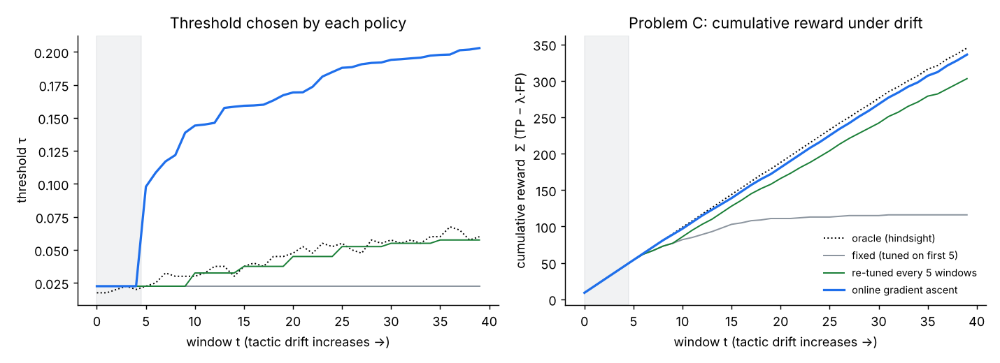
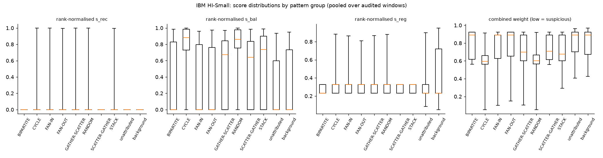
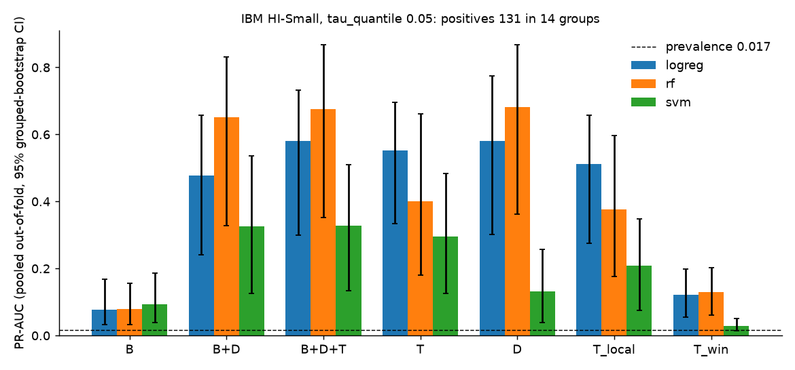
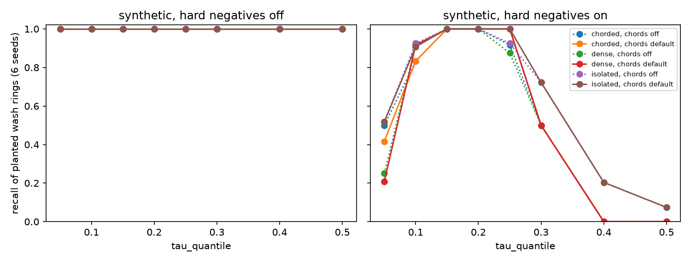
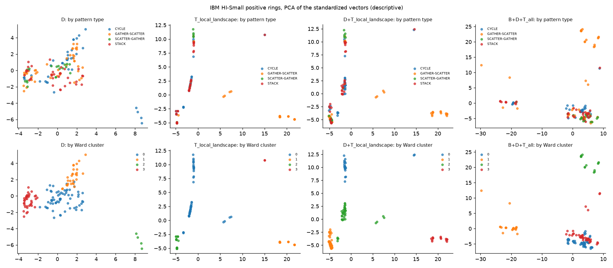
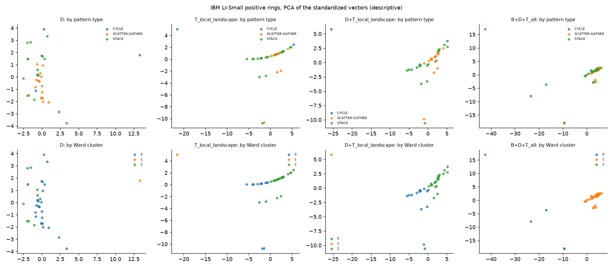
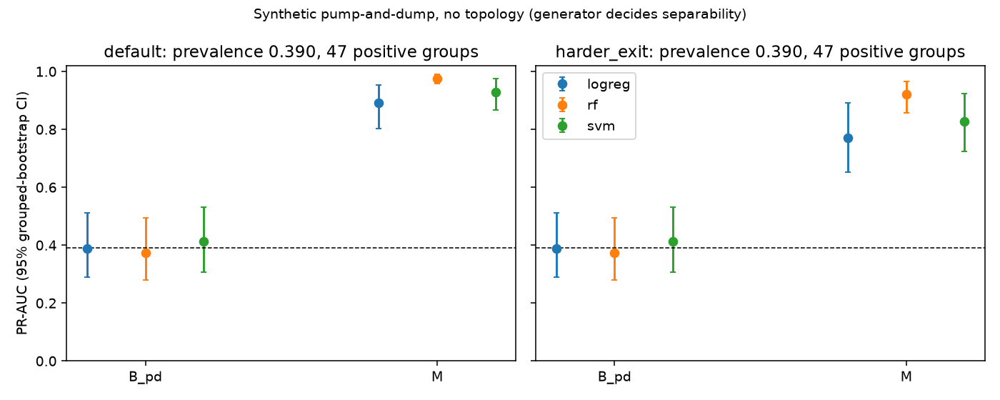

# Topological Ring Detection for Market Manipulation: a self-contained explainer

*Everything in this document was produced by the code in this repository. Every number comes from a result file or from `paper/numbers_pack.md`, which cites its source file, config and seeds. Where the code and an older document disagree, the code is followed and the disagreement is stated (section 11.3). Exploratory results are marked exploratory; nothing in this project is a pass/fail gate.*

## 1. One-page summary

**The question.** Wash trading (accounts trading assets round and round among themselves to fake volume) and money-laundering rings both show up as a *loop* in the graph of who paid whom, not as one odd transaction. Does a topological description of that loop, computed with persistent homology on a directed graph, help a classifier tell manipulation rings from benign loops, beyond what a graph-density-and-centrality baseline plus the ring's own behaviour already gives?

**The method in five sentences.**
1. Cut the transactions into time windows and build one directed graph per window, one edge per ordered account pair, each edge carrying a suspiciousness weight built from three behaviour scores (lower weight = more suspicious).
2. Find candidate rings exactly: keep the most suspicious edges, take strongly connected components, enumerate directed simple cycles up to length 6; each cycle is an explicit set of accounts.
3. For each candidate, compute persistent homology of a *directed flag complex* of the ring's neighbourhood (a circular triangle stays "open", a one-way triangle is "filled"), turn the result into fixed-length topological features (T), and put them next to graph baseline features (B) and direction/behaviour features (D, which include the ring's birth value).
4. Train classical classifiers (logistic regression, random forest, RBF-SVM; fixed hyperparameters) with grouped cross-validation so that overlapping rings never sit in both train and test, and compare **B+D+T against B+D** with grouped-bootstrap confidence intervals.
5. Around that, test an adaptive flagging threshold (online gradient ascent and two bandit policies) under simulated drift, and run exploratory clustering, a synthetic-only severity regression, a cap sensitivity study and a small synthetic pump-and-dump track that contains no topology.

**Six headline findings (positive and negative).**
1. *Adding D to B helps on real-structure data.* On IBM HI-Small the paired gain of B+D over B has a CI excluding 0 for all three models; on LI-Small for two of three (section 8.3, 8.4).
2. *No detectable topological lift on IBM; the CIs cannot rule out a small effect either way.* The pre-specified primary comparison B+D+T minus B+D has a CI that includes 0 for all three models on HI-Small (14 positive groups; logistic regression +0.104 [-0.002, +0.171]) and on LI-Small (10 positive groups) (sections 8.3, 8.4).
3. *On synthetic data topology gives a small lift where B+D is already high.* B+D+T beats B+D by a paired CI above 0 in 7 of 12 condition-model cells. B+D itself scores 0.960-0.983 (logistic regression), 0.956-0.997 (random forest) and 0.874-0.937 (SVM) over the four conditions, and the generator is nearly separable by the D features alone (section 8.6).
4. *The ring-birth signal does not carry from HI to LI.* `-D_birth` alone scores 0.314 on HI at prevalence 0.0173 and 0.006 on LI at prevalence 0.0039 (section 8.5).
5. *The adaptive-threshold bandits lose to periodic re-tuning* at the primary setting (lambda 1, lag 2), while the existing online gradient ascent reaches 0.981 of the hindsight oracle (section 8.9).
6. *Severity regression (synthetic only; the generator decides that rings persist) recovers generator structure, not forecasting skill:* ring size (`D_length`) alone matches or beats B+D for random forest and gradient boosting (rf importance of `D_length` 0.796), and T adds nothing (section 8.10). It is a descriptive finding, not a supported claim.

**What was not done.** The NFT real-data experiment (Phase 5; Dune's free tier blocks running queries), real-data pump-and-dump validation (the optional pump-and-dump track exists only as a synthetic, no-topology run), the undirected-complex and persistence-image ablations, classifiers on single-score filtrations, and sweeps over window length, stride, label threshold and (for classification) tau (section 11.4).

**How to read this document.** Sections 2-4 explain the problem and the idea from scratch. Sections 5-7 explain the data, the implementation and the evaluation protocol. Section 8 gives each result with its setup, a table and a one-line honest conclusion. Sections 9-12 draw conclusions, compare with other work, list limitations and tell the story of the decisions. Sections 13-14 give reproduction commands, a glossary and a question-and-answer list for an examiner.

## 2. Problem statement

### 2.1 What we are trying to catch

**Wash trading** is trading with yourself through a front: a group of colluding accounts repeatedly send an asset (or money) to one another so that the last recipient hands it back to the first. Nothing economic happens, but the trade count and volume go up, which can mislead other participants about demand. **Layering and cycling in money laundering** has the same shape: value is passed through several accounts and returns near its origin, so its source is hard to trace. The IBM AML data we use contains such laundering patterns with labels (section 5.2).

The unit of interest is a **ring**: a small set of accounts a1, a2, ..., ak and a directed cycle of payments a1 to a2 to ... to ak to a1, repeated or approximately repeated.

### 2.2 Why single transactions do not reveal it

Each payment in a ring looks ordinary: normal amount, normal counterparties, normal time. A transaction-level anomaly detector scores each payment in isolation and sees nothing odd. What is odd is the *pattern of connections*: money circulates and nets to about zero for each member. That is a statement about a *graph* (accounts are nodes, payments are directed edges), and specifically about a loop in it.

### 2.3 The two gaps this project targets

These come from section 1 of the v3 proposal (`Topological_Ring_Detection_for_Market_Manipulation_v3.md`).

1. **Density-based graph detection can miss sparse rings.** The common graph approaches (community detection, centrality scores, dense-subgraph mining, graph neural networks) are built to find tightly clustered groups. A ring can be sparse: each member trades with only two or three others, yet the loop persists. Cycle-based methods (strongly connected components, cycle enumeration) do find loops, but their answer is binary (a cycle is flagged or not): no strength, no stability, no type.
2. **Fixed detection thresholds decay.** Manipulators change ring size, timing and the use of decoy trades. A flagging threshold tuned once on history degrades as tactics drift.

The v3 proposal also notes prior persistent-homology work on blockchain networks that flags *that the network's shape changed* without isolating individual rings or typing them (section 3).

### 2.4 Scope

| Pattern | Status in this project |
|---|---|
| Closed-cycle wash trading and laundering cycles | **In scope**, the load-bearing target |
| Pump-and-dump coordination (a temporal motif, not a closed cycle) | Optional stretch track; done only as a **synthetic, no-topology** exploratory run (section 8.14); no real-data result |
| Spoofing | **Out of scope**: it is an order-book phenomenon (orders placed and cancelled without executing); settled transaction data has no signal for it |

### 2.5 What "detect" means here

We do not try to label whole accounts. We (a) generate *candidate rings* exactly, then (b) decide for each candidate whether it is a manipulation ring (classification), optionally what type it is (clustering) and how large its next-window activity will be (regression, synthetic only), and (c) keep the flagging threshold current under drift. The central scientific question is narrower: *given the candidate and its direction and behaviour features, do topological features add predictive value?* The primary comparison is therefore **B+D+T versus B+D** (section 4.9).

## 3. Existing solutions and their limits

This section describes method *families* in general terms. Where a specific paper is named, it was checked (URLs in the reference list at the end of section 14); where a claim about a family rests on common knowledge that we did not verify against a specific source, it is marked [citation needed]. We did not run any of these methods ourselves (section 10.3).

### 3.1 Density and community methods

*What they do.* Partition the graph into communities or find dense subgraphs, then score groups that are unusually tightly connected, on the idea that colluding accounts trade mostly with each other. [citation needed]

*What they miss and why.* A ring of three accounts has three edges: it is not dense in any useful sense, and a ring spread across a heavy-tailed graph is not a community. Density is a statement about how many edges exist among a set of nodes; a loop is a statement about the *direction* in which the few edges point. A dense blob of one-way traffic scores high and is harmless; a sparse loop scores low and is the target.

### 3.2 Centrality scores

*What they do.* Score each node by how central it is (degree, betweenness, PageRank and relatives) and flag accounts that are unusually central or unusually peripheral. [citation needed]

*What they miss and why.* Centrality describes a node's position, not whether value circulates back. A ring member can have ordinary centrality. We still use degrees, betweenness and clustering as the **B baseline features** (section 4.8), because they are the honest comparison: if topology cannot beat them, it is not adding value.

### 3.3 Graph neural networks (GNNs)

*What they do.* Learn node, edge or subgraph representations by passing messages along edges and train a classifier on labelled data. The AMLworld paper (Altman et al., NeurIPS 2023, Datasets and Benchmarks track) released the IBM data we use and ran baselines with graph neural networks and gradient-boosted trees (section 5.2).

*What they miss and why.* This is not a defect of GNNs in general, but of using them here: they need substantial labelled data and tuning, are hard to interpret ("which loop, how strong?"), and our design rules out deep learning (classical methods only), so **we did not compare against a GNN**. We cannot claim to beat one (section 10.3).

### 3.4 Cycle enumeration and strongly connected components

*What they do.* Find strongly connected components (groups where every node can reach every other) and list simple directed cycles up to a length bound. Every account-level ring is found exactly. [citation needed for the specific enumeration algorithms]

*What they miss and why.* The answer is **binary**: a cycle either exists or it does not. There is no measure of how strong it is (how suspicious are its edges), how stable it is as thresholds change, or whether its neighbourhood fills, splits or crowds it. Lots of benign loops exist too (arbitrage, market making, exchange hot wallets), so enumeration alone has a false-positive problem. In *our* pipeline cycle enumeration is kept as the localiser (section 4.7) and the new information we test is what persistence adds on top.

### 3.5 Persistent homology on blockchain graphs

*What it does.* Ofori-Boateng, Segovia Dominguez, Kantarcioglu, Akcora and Gel ("Topological Anomaly Detection in Dynamic Multilayer Blockchain Networks", ECML PKDD 2021, arXiv:2106.01806) use *clique* persistent homology to track the shape of multilayer transaction graphs over time, introduce a "stacked persistence diagram" and prove it stable under small perturbations. They report results on Ethereum and the Ripple Credit Network.

*What it misses (for our purpose).* As the v3 proposal puts it, that line of work flags that the network's *global shape changed*; it does not isolate an individual ring, type rings, or produce a per-ring strength. Two technical points matter here. Clique persistent homology is defined on an *undirected* clique complex, and in an undirected clique complex every triangle is filled, so a circular triangle A to B to C to A is indistinguishable from a transitive one (section 4.5). We did not run the undirected ablation (section 11.4), so this difference is argued, not measured.

### 3.6 Fixed-threshold alarming

*What it does.* Flag a candidate when its score passes a cutoff tuned on history.

*What it misses and why.* Tactics drift (ring timing becomes more irregular, amounts noisier, decoy trades appear), so the best cutoff moves. The optimization report in this repository measures the damage on synthetic drift: a threshold frozen after the first windows earns about a quarter of the hindsight-optimal reward (section 8.1, 8.9).

### 3.7 Summary table

| Family | Finds loops? | Strength score? | Typing? | Uses direction? | Why it falls short for rings |
|---|---|---|---|---|---|
| Density / community | No (finds blobs) | density | No | usually no | sparse loops are not dense |
| Centrality | No | node centrality | No | partly | position, not circulation |
| GNN | Learned | learned score | possible | yes | needs labels; opaque; not tested here |
| Cycle enumeration / SCC | Yes, exactly | none (binary) | No | yes | no strength or stability; many benign loops |
| Clique persistent homology | Global shape only | global | No | no (undirected) | does not isolate rings |
| Fixed threshold | n/a | n/a | n/a | n/a | decays under drift |

## 4. Our solution: the concept, from scratch

The idea in one paragraph: turn each window of transactions into a directed graph whose edge weights say how suspicious each account pair's behaviour is; list candidate rings exactly; and for each candidate ask a topological question, "is this loop ever *filled in* by other accounts' edges as we admit less-suspicious edges?", whose answer is a continuous, comparable set of features. The rest of this section builds each piece from a tiny example.

### 4.1 One graph per time window

Transactions have a timestamp, a sender, a receiver and an amount. We slice time into windows of a fixed length (5 days, sliding by 1 day on IBM; one-day windows in the severity study) and, inside each window, collapse all payments from a to b into **one directed edge a to b** carrying: the total volume, the number of payments, and the coefficient of variation (CV) of the gaps between payments (std of gaps divided by mean gap; small CV = regular timing). The graph is **directed** because a to b and b to a are different edges.

*Example.* In one window: a pays b ten times, b pays c ten times, c pays a ten times, all at regular intervals and for similar amounts. The window graph has three edges forming a loop. Another account d pays a once.

### 4.2 Suspiciousness weights, and why lower means more suspicious

Each edge gets three scores in [0, 1], higher = more suspicious (the formulas are in section 6.2):

* `s_rec` **pair reciprocity**: do a and b trade back and forth in balanced volumes?
* `s_bal` **node flow balance**: do both endpoints receive about as much as they send? (Money that circulates nets to about zero.)
* `s_reg` **timing regularity**: are payments evenly spaced? (Bots and scripted wash trades are regular.)

Each score is replaced by its *rank within the window* (so no score dominates by scale), the three ranks are averaged, and the edge weight is `1 minus that average`. So **a suspicious edge has a low weight**. We choose "low = suspicious" because persistent homology is built on a *sublevel-set filtration*: it admits cells in order of increasing value, so suspicious edges must have small values to enter first.

### 4.3 Filtration and sublevel sets

Imagine a threshold t that rises from 0 to 1. At each t, keep only edges with weight at most t. That nested family of graphs (more edges as t rises) is a **filtration**. At t = 0.1 only the very suspicious edges exist; at t = 1 everything does. A loop made of suspicious edges appears early (at a low t); a loop that needs a less suspicious edge appears later. The value of t at which a ring first exists is its **birth**: the largest weight among its edges (all its edges must be present). Ring birth is a natural suspiciousness score for the ring, and it is a feature of the ring's *own* edges, which is why it sits in D, not T (section 4.8).

### 4.4 Simplicial complexes, homology and persistence

A graph has only nodes (0-dimensional cells) and edges (1-dimensional). A **simplicial complex** adds higher cells: triangles (2-cells) and so on, glued along edges. The **flag complex** rule is: wherever a set of nodes is pairwise connected by edges, fill that whole clique with a cell.

**Homology** counts holes. **H0** counts connected components. **H1** counts independent loops that are not filled in by 2-cells: a hollow triangle has one H1 class (a loop with nothing inside); a filled triangle has none.

**Persistent homology** follows these holes along the filtration. A hole is **born** at the t where its loop first exists and **dies** at the t where something fills it. The pair (birth, death) is a **bar**; the set of bars is a **persistence diagram**; a long bar means a loop that lasts across many thresholds. A loop that is never filled has death = infinity: an **infinite bar**. Because machine-learning features need finite numbers, we **cap** infinite deaths at a documented value (by default the window's largest edge weight; section 6.5) and count infinite bars separately before capping.

### 4.5 Why a DIRECTED flag complex

This is the key design choice (v3 section 3.2). Take the three-edge loop a to b to c to a (**circular triangle**) and the three edges a to b, b to c, a to c (**transitive triangle**: one-way flow, no circulation).

```
 circular (a ring)              transitive (one-way flow)

     a                               a
    / ^                             / \
   v   \                           v   v
   b -> c                         b --> c
 a->b, b->c, c->a               a->b, b->c, a->c
```

* In an **undirected** clique complex both are three pairwise-connected nodes, so both are filled by a triangle: the ring's loop dies instantly and the two cases cannot be told apart.
* In a **directed flag complex** a triangle is filled only if the three edges can be ordered as a "source, middle, sink" (a to b, a to c, b to c). The transitive triangle has that ordering: it is filled, so it has no H1 class. The circular triangle has none: it is *never filled*, so its H1 class survives as an infinite bar. This is exactly "value circulates" versus "value flows one way".

The implementation (`topology/persistence.py`) builds cells exactly this way: nodes at filtration 0, directed edges at their weight, and 2-cells for ordered triples (a, b, c) with edges a to b, a to c and b to c, entering at the largest of their edge weights. A reciprocal pair a to b and b to a gives two distinct edge cells, so ping-pong trading forms its own loop.

### 4.6 What persistence adds beyond enumeration

*A third example: a ring filled by a fourth account.* Take the circular triangle a, b, c with weights 0.1 and add d with edges d to a, d to b, d to c at weight 0.6. The triples (d, a, b), (d, b, c), (d, c, a) are transitive, so as t reaches 0.6 the loop gets filled and the H1 class **dies at 0.6**. Enumeration still lists a, b, c as a ring; persistence says the loop is open only between 0.1 and 0.6 (a bar of length 0.5). If d had been absent the bar would never die.

So persistence carries *extra* information only when the ring's neighbourhood interacts with it: a fourth account fills it (shortcut-filled), chords split a long ring into shorter cycles (chorded), or many incidental loops crowd it (dense). For an **isolated** ring in a sparse neighbourhood the H1 class is born at the ring's birth value and never dies, so persistence is nearly redundant with enumeration. This is the central hypothesis of the project, and it is why synthetic scenarios (section 5.1) have these three shapes.

### 4.7 Why we find rings by SCC and cycle enumeration, not by homology

The libraries that compute directed flag persistence (flagser, via pyflagser) return the persistence pairs but **no representative cycle**: they tell us that a loop exists with some (birth, death) but not *which accounts* form it. For a detection system we need account-level answers. So localisation is done combinatorially and exactly (`topology/candidates.py`): (1) sparsify, keeping only edges with weight at most a cutoff tau; (2) find strongly connected components; (3) enumerate simple directed cycles up to length 6 inside each component (capped at 20000 cycles per component, with capped components reported, never silently dropped); (4) de-duplicate. Persistence then supplies *features* of each candidate's neighbourhood.

### 4.8 Persistence landscapes and the three feature families

A persistence diagram has a variable number of points, which classifiers cannot ingest. A **persistence landscape** (Bubenik, JMLR 2015) turns a diagram into a few piecewise-linear functions of the threshold; sampled on a fixed grid they give a fixed-length vector. We use 3 landscapes of 50 grid points on [0, 1.1] for the H1 diagram.

* **B (graph baseline)**, 12 columns: member degrees, betweenness, clustering, neighbourhood weight variance, density and size. The density/centrality baseline of section 3.
* **D (direction/behaviour)**, 17 columns: ring length, **ring birth**, edge weights, the mean and minimum of each rank-normalised score along the ring, member degree imbalance, volume and timing statistics.
* **T (topological)**, 311 columns: for the ring's neighbourhood (**T_local**, 156 columns) and for the whole sparsified window (**T_win**, 155 columns, identical for every ring in a window): landscape values, counts of H1 and H0 classes, infinite-bar count, total persistence, persistence entropy and, for T_local, `T_local_ring_inf`, an exact test that *this ring's own loop* is never filled.

**Why ring birth is in D, not T.** Birth is a function of the ring's own edge weights; counting it in T would credit topology for something enumeration already gives (the proposal's own warning). T contains only quantities that need a homology computation.

### 4.9 Why the primary comparison is B+D+T versus B+D

If we compared T against nothing, any gain could come from direction or behaviour information. B+D is the strongest non-topological feature set; adding T and asking whether performance rises isolates the *topological increment*. A null result there is reportable and is what we found on IBM (section 8.3). Secondary comparisons are B+D versus B (does direction/behaviour help?) and, labelled exploratory, B+D+T_local and B+D+T_win versus B+D (separating the local ring features from the window-constant ones).

### 4.10 The adaptive-threshold idea

A candidate is flagged when its score is at most a threshold tau (low ring birth = suspicious). The **reward** per window is `TP minus lambda times FP` (true positives minus a penalty for false positives). As tactics drift the best tau moves, but labels arrive late: you learn that a flagged ring was real only d windows later. The project compares:

| Policy | Idea |
|---|---|
| fixed | tune tau on the first few windows, freeze |
| re-tuned (every M windows) | refit the best tau on recent *labelled* windows, with the same lag |
| online gradient ascent | nudge tau uphill on a smoothed reward using the newest labelled window |
| discounted UCB | a bandit over K = 10 fixed thresholds that discounts old rewards |
| sliding-window Thompson sampling | a bandit that samples from per-arm beliefs built from the last W windows only |
| oracle | the best tau for each window using its own labels (an upper bound, not achievable) |

The proposal's primary comparison is *bandit versus re-tuned at the same lag*.

## 5. Data

Three data sources were planned; two were used.

### 5.1 The synthetic generator (`src/ringtda/data/synthetic.py`)

**Why synthetic data.** Real labelled wash trading is scarce and its labels are heuristic. A generator that *plants* structures gives exact ground truth: we know which accounts form each ring, so every later stage can be tested against a known answer. The price is **generator circularity**: the designer decides what the data look like, so a method can look good simply because it matches the designer's assumptions (section 11.1).

**Background.** Heavy-tailed account activity (a few accounts are very active), irregular timing, lognormal amounts, mostly one-directional traffic. By default 400 accounts and 6000 background transactions over one week.

**Planted structures.** Each planted structure has a pattern name, a scenario, its accounts and edges, and its own transaction rows carrying a `pattern_id`.

| Structure | What is planted | Class |
|---|---|---|
| `wash_ring`, scenario **isolated** | near-equal amounts around a directed cycle (sizes 2, 3, 5) on a regular cadence (one round about every 4 hours), sparse neighbourhood | positive |
| `wash_ring`, scenario **dense** | the same rings embedded among extra accounts with random incidental traffic, so many incidental loops cross the ring | positive |
| `wash_ring`, scenario **chorded** | a longer ring (size 6) plus forward chords; each round takes the full ring or a shortcut, so every node still nets to zero but the loop splits into shorter cycles | positive |
| `transitive_decoy` | a to b, b to c, a to c: regular, similar amounts, one-way | negative (topology-sensitive); has no cycle, so never becomes a candidate |
| `shortcut_filled` | a regular circular triangle plus a fourth account paying all three members, which fills the loop | negative (topology-sensitive): ring-like under enumeration, but its H1 class dies |
| `arbitrage_loop` | three-party loops fired by random price events with a small profit per hop | hard negative (legitimate loop) |
| `market_maker` | a hub trading both ways with clients at random times and sizes | hard negative |
| `hot_wallet` | an exchange hub with many random deposits and withdrawals; in and out nearly equal | hard negative |

Hard negatives can be switched off (`hard_negatives=False`) to give the "without hard negatives" runs.

**Drift and evasion knobs.** `ring_jitter` (timing noise as a fraction of the period), `amount_noise`, `wash_decoy_frac` (decoy trades to outsiders) and `mm_regularity`. The drift benchmark (section 8.9) raises jitter and amount noise over the stream.

**The dense scenario mostly gets filled (a finding about the generator).** In the dense scenario incidental traffic can fill the planted ring's loop, so its H1 class dies. With the default setting a planted dense ring is still labelled positive, because the label comes from the planted structure, not from topology. `dense_internal_chords=False` removes incidental edges *between members of the same ring*, leaving filling only by outside accounts. We report dense results under both settings (section 8.6).

**Reproducibility.** The default random stream is unchanged by later additions (digests in `tests/test_synthetic_scenarios.py`), and the optimization report's generator is pinned (dense, chorded, shortcut-filled and hot-wallet counts set to 0) so its numbers never change.

### 5.2 IBM AMLworld (HI-Small and LI-Small)

**What it is.** Altman, Blanuša, von Niederhäusern, Egressy, Anghel and Atasu, "Realistic Synthetic Financial Transactions for Anti-Money Laundering Models" (NeurIPS 2023, Datasets and Benchmarks): a multi-agent simulator, calibrated to resemble real transactions, that produces labelled synthetic datasets. **HI** and **LI** are the high- and low-illicit-rate "Small" variants. Because the data are synthetic the ground truth is complete.

**Files.** A transactions file (timestamp, source and destination bank and account, amounts and currencies, a laundering flag) and a **patterns file** listing each laundering *attempt* (a numbered block with a pattern type, e.g. CYCLE) and the transactions in it. Our loader (`data/ibm_aml.py`) joins pattern rows to transactions on (timestamp, accounts, amount); duplicate keys are paired deterministically, laundering rows first.

**Pattern types seen in positives:** CYCLE, GATHER-SCATTER, SCATTER-GATHER and STACK. The patterns file also contains BIPARTITE, FAN-IN, FAN-OUT and RANDOM attempts, which appear in the audit (section 8.2) but produce no positive candidates at tau 0.05 and max_len 6.

**Cleaning decisions.**
* **Self-loops dropped.** Rows with source equal to destination are removed and counted by the loader (HI-Small: 591,212 of 5,078,345 rows, 11.6%); node in/out totals therefore use inter-account flow only.
* **Currencies.** `Amount Paid` is used as is, in its own currency (15 currencies, no exchange rates in the data); volume ratios mix currencies. A stated limitation.
* **Unattributed laundering rows.** 1,968 of the 5,177 laundering rows belong to no attempt in the patterns file. A candidate whose laundering-flagged edges rest only on such rows is labelled **ambiguous**, and results are reported with ambiguous candidates excluded (primary) and counted positive.
* **What the pack records.** The pack's setup table gives the transactions kept, the windows and the candidate counts (section 8.3).

**Why the IBM data is not market wash trading.** IBM laundering patterns are often one-directional, may decay in amount and need not be regular in time, so the wash-trading behaviour scores need not describe them. The v3 proposal therefore uses IBM to validate the *pipeline machinery* and runs a pattern-behaviour audit first (section 8.2).

### 5.3 NFT data (planned, inspected, not run)

**Plan.** Ethereum NFT trades from Dune or Google BigQuery, with proxy wash-trade labels from Dune's `nft.wash_trades`, and a label-provenance audit. **What was done.** BigQuery access was confirmed and the table schemas were inspected. **Why it was not run.** Running queries on Dune is blocked on the free tier. **Leakage design.** `nft.wash_trades` combines five filters; filters 2 and 3 are cycle-type rules, so labels from them would leak the very structure our method detects. The planned leakage-controlled subset was therefore filters 4 and 5 only. No NFT result exists, so **we make no claim beyond synthetic and IBM data**.

### 5.4 The synthetic pump-and-dump generator (optional track; no topology)

A separate generator (`data/pump_dump.py`; `synthetic.py` is untouched) makes one asset with a noisy hourly price and account-level buys and sells. Planted groups of 5 to 8 accounts: **pump-and-dump** groups accumulate in a 12-hour band, then all sell around a common exit time while the price runs up and falls back (the positives); **organic** momentum groups accumulate the same way but sell at independent times over days; **news** groups accumulate, then a price spike and unsynchronised sellers follow (a hard negative). Groups sit in separate time slots; background traders are independent with small trades. Hardness is set by the spread of the planted exit times. As with the ring generator, **the author decides how separable the classes are**.

## 6. Implementation, stage by stage

### 6.1 Repository map and data flow

```
src/ringtda/
  data/        synthetic.py  ibm_aml.py  toy.py            transactions + ground truth
  graph/       windows.py  weights.py                       windows, per-pair aggregation, scores, weights
               baseline_features.py  direction_features.py  B and D features
  topology/    candidates.py  persistence.py  vectorize.py  rings, persistence, T features
  eval/        labels.py splits.py metrics.py audit.py recall.py
  models/      gd.py  classify.py  cluster.py  regress.py   learning and evaluation models
  threshold/   ascent.py  bandit_sim.py                     adaptive thresholds
  features.py  ibm_table.py  synthetic_table.py             table builders
configs/       topology.yaml features.yaml ibm.yaml classify.yaml bandit.yaml cluster.yaml regress.yaml cap_sensitivity.yaml
experiments/   one script per experiment (+ plot scripts, make_numbers_pack.py)
tests/         tests on tiny synthetic cases for every module
paper/         numbers_pack.md (every number, with provenance), figure_list.md, this explainer
results/       outputs (git-ignored); results/report and results/gd_metrics.json are never overwritten
```

```
transactions --> windows --> per-pair edges --> scores --> rank-normalise --> weight
                                                                   |
        window graph G (weights)                                   v
              |--> sparsify at tau --> SCC --> bounded cycles --> candidate rings
              |                                                   |
              |--> B features (full graph) <----------------------|
              |--> D features (ring edges, ring birth) <----------|
              '--> directed flag persistence (flagser | reference) of the ring's
                   neighbourhood and of the sparsified window --> cap --> landscapes --> T
labels (planted structure | IBM attempt) --> label rule X=80% --> y / kind / group
        B, D, T + y + group --> grouped CV --> classifiers --> pooled out-of-fold scores
                                              --> grouped bootstrap CIs, paired differences
```

### 6.2 Windows, aggregation, scores and weights (`graph/windows.py`, `graph/weights.py`)

`iter_windows` yields transactions in [start, start + length). `aggregate_pairs` collapses a window to one row per ordered pair (src, dst): volume (sum of amounts), count, `gap_cv` (CV of gaps between payments; **needs at least 3 payments**, otherwise undefined), and first and last time.

Scores (all in [0, 1], higher = more suspicious), with V_ab the volume from a to b in the window:

* **Pair reciprocity** `s_rec = 1 - |V_ab - V_ba| / (V_ab + V_ba)`. It is 1 for perfectly balanced two-way trade and 0 for one-way flow.
* **Node flow balance.** For a node x with in-volume in(x) and out-volume out(x): `beta(x) = 1 - |in - out| / (in + out)`; the edge score is `s_bal = min(beta(a), beta(b))`.
* **Timing regularity** `s_reg = 1 / (1 + CV)` where CV is `gap_cv`. Pairs with fewer than 3 payments have no CV; in `weights.compute_scores` they receive the window **median** regularity.

**Rank normalisation.** Each score is mapped to `(rank_min - 1) / (n - 1)` within the window; ties take the *lowest* rank. This matters because most edges have `s_rec = 0`: with average ranks that tied block would land mid-scale and look moderately suspicious. **Weight** `w = 1 - mean(normalised scores)`, so low weight = suspicious.

**Proposition 1 (the one-third floor), why alpha is learned.** In a ring of three or more accounts with no reciprocal pair, the normalised reciprocity score is 0 on every edge, so with weights `w = 1 - alpha . z` and equal alpha = (1/3, 1/3, 1/3) the weight is at least 1/3 no matter how perfect the ring's balance and timing. A multi-party ring can therefore never look maximally suspicious under equal weights. This motivates *learning* alpha on the probability simplex (section 6.10); in the optimization report's experiment the learned alpha is (0.0, 0.2067, 0.7933) for (reciprocity, balance, regularity): zero weight on reciprocity, most on timing regularity.

### 6.3 Sparsification, candidates and de-duplication (`topology/candidates.py`)

`sparsify(G, tau)` keeps edges with weight at most tau. In the table builders tau is a *quantile* of the window's edge weights (default 0.25 on synthetic data; **0.05 on IBM**, so only the most suspicious 5% of edges survive). `candidate_rings` then finds SCCs with at least 2 nodes, enumerates simple directed cycles up to `max_len` = 6 (networkx), caps enumeration at 20000 cycles per SCC and records capped components in `truncated_sccs`. Each cycle becomes a **Candidate**: its accounts in canonical order, its edges, and its **birth** (maximum edge weight on the ring).

**De-duplication, and what the code really does.** The proposal says to keep the lowest-birth cycle among near-duplicates; the code sorts shorter first, then by birth, and drops a cycle when at least 80% of its edges are covered by a kept cycle. **A k-cycle shares at most k-2 edges with any cycle of length at most k, so at 80% overlap nothing is removed for `max_len` at most 9** (first removals at 10; checked in `tests/test_candidates.py`). Dedup is therefore effectively off, near-duplicate rings all stay candidates, and cross-validation must group by ring identity (section 6.8).

### 6.4 Persistence backends (`topology/persistence.py`)

`directed_flag_persistence(G, backend)` returns H0 and H1 diagrams of the weighted directed flag complex of dimension 2: nodes at filtration 0, directed edges at their weight, ordered triples (a, b, c) with a to b, a to c, b to c at the maximum edge weight. Two backends: **flagser** (via pyflagser, fast C++, the engine of Lütgehetmann, Govc, Smith and Levi, "Computing persistent homology of directed flag complexes", Algorithms 2020) and **reference** (pure-Python Z/2 boundary-matrix reduction). They **must agree** (to a tolerance, because flagser works in float32 and differs by about 1e-7); `tests/test_directed_triangles.py` checks that, plus the canonical gates: a cyclic triangle gives one infinite H1 bar, a transitive triangle gives none, a shortcut-filled triangle dies at the fill weight, a reciprocal pair gives an H1 class. The reference backend exists as an auditable cross-check and a fallback.

### 6.5 T features (`topology/vectorize.py`, `configs/topology.yaml`)

**Local.** For each candidate take the induced subgraph on the ring plus its **1-hop** in- and out-neighbours, taken from the *sparsified* graph by default, compute H0 and H1, **cap** and vectorise. **Window.** Compute the diagrams of the whole sparsified window once and repeat the values on each ring of the window (`T_win`).

**Cap rules.** An infinite H1 bar needs a finite death for a landscape. `window_max` (default): the window's maximum edge weight. `fixed`: a constant (the legacy report used 1.0). `window_max_x`: window max times a factor. Infinite bars are *counted before capping* (`inf_h1`), so the count does not depend on the rule; a bar born at or above the cap is dropped from the landscape input but still counted.

**Vector.** 3 landscapes x 50 grid points on [0, 1.1] (150 numbers) plus scalars: H1 count, infinite H1 count, H0 count, total persistence, persistence entropy, and for T_local `ring_inf`. Total T columns: 156 local plus 155 window.

**`T_local_ring_inf`: the exact ring-survival test.** The question "is *this ring's* loop never filled?" is not answered by "there is an infinite bar born near the ring's birth" (a birth-match proxy that misses rings homologous to an earlier loop). The code (`ring_survives`) answers it exactly over Z/2: it writes the ring's loop as a vector over the directed edges of the neighbourhood, builds the boundary matrix of the directed 2-cells (a, b, c) with boundary ab + bc + ac, and checks by Gaussian elimination whether the loop vector lies in the column space. If it does the loop is filled; if not it survives. A size guard (5000 edges, 200000 triangles) falls back to the birth-match proxy and logs it.

### 6.6 D and B features (`graph/direction_features.py`, `graph/baseline_features.py`)

**D (17).** `D_length`, `D_birth`, `D_mean_w`, `D_min_w`, mean and minimum of each normalised score along the ring (`D_rec_*`, `D_bal_*`, `D_reg_*`), member degree imbalance (mean, max), `D_log_volume`, `D_vol_ratio`, `D_vol_cv`, `D_gap_cv_mean`, `D_log_count_mean`. Pairs without a defined `gap_cv` take the **window median of the defined gap CVs** (`gap_cv_fill`): a *different* fill from the weights' median-of-regularity fill (a code detail, section 11.3).

**B (12).** Member degrees (mean and max of total, in and out), betweenness (mean, max), mean clustering, variance of weights in the neighbourhood, density, neighbourhood size, all on the **full** window graph, so B sees at least as much of the graph as T (T uses the sparsified one).

**Betweenness and its sparsity.** Exact betweenness is infeasible on IBM windows (about 400k nodes), so windows with more than 3000 nodes use **k = 100 sampled sources** with a fixed seed, computed once per window and cached. Sampling leaves most nodes at exactly 0: in HI window 0 only a minority of nodes have non-zero betweenness (section 11.2).

**Leakage guard.** The feature builders take only the weighted window graph and a Candidate. They never receive planted structures, labels, attempt ids or scenario names; `tests/test_feature_leakage.py` and the feature-set tests check that no label, key, group or scenario column enters a feature set.


### 6.7 Labels (`eval/labels.py`)

**The ring-labelling rule (v3 section 3.7, X = 80%).** A transaction *backs* an edge for a structure if it is one of the structure's *own* transactions (decoy, context and background rows back nothing). For a candidate ring with edges E:

* if at least X = 80% of E is backed by **one** structure, the candidate gets that structure's pattern as its kind (synthetic: `wash_ring` gives y = 1, any other pattern y = 0; IBM: any laundering attempt type gives y = 1);
* if **no** edge is backed it is `background` (y = 0); on IBM, a ring whose flagged edges rest only on laundering rows that belong to no attempt is `ambiguous` instead;
* otherwise it is `ambiguous` (y undefined).

For planted rings of size 2, 3 and 5 the 80% and 100% rules agree; they differ only for structures with more edges than one cycle (a chorded 6-ring: four of five edges backed counts as positive at 80%).

**Both ways of counting ambiguity.** Ambiguous candidates are reported **excluded** (the *primary* variant) and **counted positive** (the *ambiguous-positive* variant). Synthetic runs with hard negatives on show why this matters: most candidates are ambiguous (section 8.6).

**Cycle-only subset.** Positives from CYCLE attempts only, with other-type positives and ambiguous candidates removed and background kept. The proposal does not define it; this is our definition (section 11.3).

### 6.8 Groups, and why rows are not independent (`eval/splits.py`)

Because dedup is effectively off and rings recur across overlapping windows, many candidates are near-copies of each other. A **group** is one unit that must stay together in cross-validation: assigned once across all windows by union-find over candidates that **share any edge**, additionally merged by **attempt id** (all candidates labelled with the same IBM attempt, or the same planted structure). A stricter **strict-groups** variant merges candidates sharing an *account*. On synthetic data groups are prefixed by seed so seeds never merge.

### 6.9 The classification harness (`models/classify.py`, `eval/metrics.py`, `experiments/ibm_classify.py`)

* **Feature sets.** B, B+D, B+D+T, T; controls D, T_local, T_win; ablations B+D+T_local and B+D+T_win (added after the first run).
* **Models, hyperparameters fixed in `configs/classify.yaml`, no search of any kind.** Logistic regression (L2, C = 1.0, 2000 iterations, class weights balanced); random forest (300 trees, balanced_subsample); RBF-SVM (C = 1.0, gamma = scale, balanced). Each is a pipeline that includes a standard scaler, so **scaling is fitted on the training fold only**.
* **Cross-validation.** Stratified *group* k-fold (k = 5; falls back to 3 if some fold would hold no positive), **5 repeats** with different seeds, so every candidate gets 5 out-of-fold scores.
* **Metric: PR-AUC** (average precision) of the **pooled out-of-fold scores**, averaged over the 5 repeats. Prevalence is always printed beside it, because the PR-AUC of a random scorer equals the prevalence.
* **Confidence intervals: grouped bootstrap.** Resample *groups* with replacement (a group's candidates get its multiplicity as weight), recompute the AP of every repeat on each resample, average over repeats, take the 2.5th and 97.5th percentiles of 1000 resamples (seed 12345).
* **Paired differences.** To compare feature sets A and B, the *same* resamples are used for both and the CI is of the difference A minus B. This is much tighter than comparing two separate intervals.
* **Single-feature reference.** `-D_birth` alone (low birth = suspicious) with no model.

**A bug that was found and fixed.** The first harness run computed AP with 0/0 at the head of the ranking when the top-ranked candidates' groups were absent from a bootstrap resample; the resulting NaNs were silently dropped, which kept only resamples containing the top items and **biased the CIs upward** (one paired CI printed [+0.032, +0.172] with "share of resamples above 0" of 0.26, which was inconsistent). The fix makes the AP zero-safe, only resamples with no positive at all are undefined; the point estimates did not change, the CIs got wider (section 12). All reported CIs are from the corrected code, with no NaN resamples.

### 6.10 The optimization report (`models/gd.py`, `threshold/ascent.py`, `experiments/gd_report.py`)

This is the earlier, self-contained part of the project: three small optimization problems written out in NumPy so each line maps to an equation of the report. It is run on a pinned synthetic generator and **its numbers are never overwritten** (`results/report/`, `results/gd_metrics.json`, `results/figures/`).

* **Problem A, a classifier by gradient descent.** Class-weighted, L2-regularised logistic regression solved by plain gradient descent. The objective is convex, so every stationary point is global; the step size 1/L (L = smoothness constant) is safe, and a step matched to the *local* curvature at the optimum converges in 322 iterations.
* **Problem B, learning alpha on the simplex.** Choose the score weights alpha (non-negative, summing to 1) to minimise a weighted logistic loss of `sigmoid(c - k * ring_birth(alpha))`, where ring birth is smoothed by a softmax (beta = 30) so it is differentiable. Each step moves alpha by a gradient step and **projects back onto the simplex**; the gradient check agrees with finite differences to about 1e-10. This is non-convex, so four starts (equal weights and the three vertices) were run and they land on nearly the same alpha.
* **Problem C, online threshold ascent.** Smooth the step-function reward `TP - lambda * FP` with a sigmoid of width T, and move tau uphill on the newest labelled window (20 small steps per window), with labels arriving d windows late. Comparators: fixed, re-tuned every M windows with the same lag, hindsight oracle.

### 6.11 Bandit simulation (`threshold/bandit_sim.py`, `experiments/bandit_report.py`)

Reuses the report's drift stream and reward. Arms are K = 10 evenly spaced thresholds on the score (0.05 to 0.95). **Bandit feedback:** only the played arm's reward is observed, and it becomes usable `max(d, 1)` windows after its window. **Warm start:** the first 5 windows are observed for all arms (the same windows that tune the fixed comparator).

* **Discounted UCB** (Garivier and Moulines, ALT 2011): an observation from window s counts with weight gamma^(t - s); index = mean + c * sqrt(ln(1 + n) / N), with gamma = 0.9, c = 0.5.
* **Sliding-window Thompson sampling [citation needed]:** a Beta(1 + successes, 1 + failures) belief per arm over the last W = 10 windows only; the normalised reward in [0, 1] becomes a Bernoulli trial when revealed; one sample per arm, play the argmax.

Rewards are clipped at +-10 and mapped to [0, 1] for the policies. **All hyperparameters were fixed in `configs/bandit.yaml` before the first run.** Comparators and the oracle come from the existing `ascent.run_policies`, unchanged; 6 seeds, seed 0 is exactly the report's stream.

### 6.12 Severity regression (`models/regress.py`, `experiments/synth_severity.py`)

**Synthetic only.** IBM has no next-window wash volume. The generator makes one week in which each planted ring runs all week, so consecutive **one-day windows** contain the same ring. A candidate at window t is matched to the same ring at t+1 by *account set and planted id*. **Target:** log1p of the ring's own wash volume in window t+1 (the sum of its own `wash_ring` transactions). **Excluded inputs:** the D columns that encode the ring's own current volume or activity (`D_log_volume`, `D_vol_ratio`, `D_vol_cv`, `D_log_count_mean`), so a persistence shortcut is not handed to the model. Ridge, random forest and gradient boosting with fixed hyperparameters; grouped CV by ring identity across 6 seeds, 5 repeats; RMSE, MAE and Spearman with grouped-bootstrap CIs.

### 6.13 Clustering (`models/cluster.py`, `experiments/ibm_cluster.py`)

**Exploratory.** Ward hierarchical clustering (Euclidean) of the *positive* IBM rings on standardised vectors, with k equal to the number of pattern types; ARI (adjusted Rand index) and purity against the pattern type, silhouette, and baselines: random relabelling of the same cluster sizes (1000 permutations) and majority-class purity. The same grouped bootstrap (500 resamples over positive groups) gives CIs; ARI against the *group id* is a check that clusters are not just recovering attempts.

### 6.14 Cap sensitivity (`experiments/cap_sensitivity.py`)

The cap only enters when diagrams are vectorised, so each window's and each ring's persistence is computed once and vectorised under every cap rule. The default `window_max` reproduces the stored T columns exactly (max absolute difference 0.0); the stored classification protocol is rerun with the same folds and bootstrap resamples. B and D columns and labels are unchanged, so B+D rows do not depend on the cap.

### 6.15 Candidate recall (`eval/recall.py`, `experiments/candidate_recall.py`)

Recall asks how many true rings the *candidate generator* returns, separately from classification. IBM: a CYCLE attempt is **complete** in a window if all its transactions fall inside it and **recovered** if a candidate has exactly the attempt's account set (the README measurement); the label-based count (the candidate also carries a positive label) is reported next to it. Synthetic: a planted wash ring is recovered if some candidate is labelled as that ring. Recall needs no features.

### 6.16 Pump-and-dump track (`motif/pump_dump.py`, `experiments/pump_dump_run.py`; synthetic only, no topology)

**Candidates** are *accumulation windows* found from trades alone: a 12-hour band in which at least 4 accounts each buy at least a set volume. **M features** (8): accumulation concentration (share of buy volume in the busiest quarter of the band), **exit synchrony** (spread of the members' first-sell times after the band), share selling within 24 hours, median exit delay, position-size dispersion, price run-up, drawdown, and group size. **B_pd** (3): group size and per-account volume, with no timing or price. Features read only the trade table and the price series (a test scrambles labels and ids and checks nothing changes); they use sells and prices *after* the band, so this is retrospective detection, not early warning. The run reuses the classification harness unchanged (same fixed hyperparameters, grouped stratified CV, grouped bootstrap, paired differences). The generator thresholds were calibrated on candidate counts before any model run, and the configuration was fixed in `configs/pump_dump.yaml` before the run.


## 7. Evaluation protocol: why it looks the way it does

**Why random splits leak.** Rings recur across overlapping windows, and with dedup effectively off a ring and its slight variants are all candidates. A random split would put one copy in training and a near-identical copy in testing, and the classifier would memorise rings instead of learning to detect them. All our primary evaluations therefore use **grouped** cross-validation, with groups defined by shared edges and attempt ids (section 6.8).

**Why a time-ordered split was dropped.** A split that trains on early rings and tests on late ones was tried as specified and was **unusable**: HI-Small left 0 test candidates and LI-Small 1, because rings recur and almost every window mixes early and late groups. The code is kept; it is reported as unusable, with no post-hoc variant. The out-of-sample check is HI to LI transfer instead, labelled as transfer and not as time-leak-free (both come from one generator and cover the same dates; the datasets share 3 accounts, used by no candidate).

**Why PR-AUC.** The positives are rare (prevalence between 0.0039 and 0.0481 across our datasets), where ROC-AUC looks flattering because true negatives dominate. Precision-recall area focuses on the positives; a random scorer scores the prevalence, so we print prevalence with every number.

**Why intervals are wide, and what the effective sample size is.** The effective sample size is the number of **positive groups**, not positive candidates: 14 on HI (131 positive candidates) and 10 on LI (38 candidates); in the split report 144 of 150 fold-repeats (three tau values, HI and LI, 5 folds, 5 repeats) hold fewer than 5 positive groups, and 50 of 50 at tau 0.05. We report the intervals as they are and do not tune anything to narrow them.

**All choices are made inside training folds.** Scaling is part of the pipeline; hyperparameters are fixed in config files and never searched; no threshold is chosen on test data.

**Pre-specified primary versus exploratory.** *Pre-specified primary:* `B+D+T minus B+D`, one row per model, dataset and variant (the v3 proposal's design); *pre-specified secondary:* `B+D minus B`. Everything else, notably the T_local and T_win ablations (added after the first HI run), per-scenario rows, cap-sensitivity rows, diagnostics and the post hoc `ring_local_max` finding, is **exploratory or sensitivity**.

**Multiplicity note.** Across the project there are 495 paired-difference rows; 55 are pre-specified primary, 47 pre-specified secondary and 393 exploratory or sensitivity. No multiplicity correction is applied anywhere, the rows within a file are not independent, and the primary count includes every variant (e.g. ambiguous-positive, strict-groups), so it counts rows, not independent tests; the headline test per dataset is the primary variant. The full table is in the pack, section 6E, reproduced in section 8.12.

**Statistical reporting rule.** Synthetic results also carry mean +- std of per-seed PR-AUC over 6 seeds (the v3 requirement of at least 5 seeds); real-data results use bootstrap CIs.


## 8. Results

Each subsection gives the **question**, the **setup**, the table(s), **how to read it** and a **one-line honest conclusion**. All tables are copied by the build script from `paper/numbers_pack.md`, which cites the source CSV, config and seeds. PR-AUC cells are `PR-AUC [95% grouped-bootstrap CI]`. Prevalence is stated with every table. CIs that include 0 (for differences) or overlap heavily (for levels) mean "not distinguishable at this sample size".

### 8.1 The optimization report (synthetic, pinned generator)

*Question.* Do the three optimization problems of section 6.10 behave as theory predicts, and how much does adapting the threshold matter? *Setup.* Pinned report generator (dense, chorded, shortcut-filled and hot-wallet counts 0, ambiguous counted as negatives); 12 training and 6 test windows for A and B; a 40-window drift stream for C. Source: `results/gd_metrics.json` (copied unchanged in the pack, section 2).

* **Problem A.** Step 1/L with L = 6.8877; the local-curvature step reaches a gap of 1e-6 in 322 iterations while the others have not by the end. The gradient-descent solution agrees with L-BFGS to 6.5e-7 in the parameters. Test AP of the D classifier is 0.9984 and of D plus the legacy topology columns 0.9969: **topology does not help the report's detector either.**
* **Problem B.** Test AP of the ring-birth detector rises from 0.5675 with equal weights to 0.9997 with the learned alpha (0.0, 0.2067, 0.7933): *learning the weights matters a great deal, because of Proposition 1.* The ring-birth detector is then close to ceiling on this generator.
* **Problem C.** Cumulative reward after warm-up as a share of the hindsight oracle: fixed 0.2367, re-tuned every 5 windows 0.86, online ascent 0.97 (figure below).



*Conclusion.* On this synthetic generator weight learning and threshold adaptation each matter; the optimization report is a synthetic-only demonstration, not evidence about real data.

### 8.2 Pattern-behaviour audit on IBM AML

*Question.* The three scores encode wash-trading behaviour. Do IBM laundering patterns actually look suspicious under them? *Setup.* HI-Small windows 0 and 2 (5 days each) pooled; for every pattern group, the edge-level AUC of that group's pairs against all background pairs for each score (0.5 = chance), and the **tail share**: the share of a group's pairs in the most suspicious 10% tail of the window (for `weight`, the lowest 10% of weights); the baseline for a score with no ties is 0.100. Source: `results/phase3_features/audit/HI_audit_summary.csv`.

| group | pairs | AUC weight | AUC s_bal | AUC s_rec | AUC s_reg | tail share weight | tail share s_bal |
|---|---|---|---|---|---|---|---|
| BIPARTITE | 238 | 0.562 | 0.564 | 0.515 | 0.557 | 0.038 | 0.176 |
| CYCLE | 208 | 0.794 | 0.795 | 0.584 | 0.601 | 0.173 | 0.433 |
| FAN-IN | 234 | 0.583 | 0.541 | 0.536 | 0.603 | 0.081 | 0.103 |
| FAN-OUT | 263 | 0.528 | 0.513 | 0.526 | 0.574 | 0.057 | 0.106 |
| GATHER-SCATTER | 408 | 0.617 | 0.591 | 0.543 | 0.595 | 0.091 | 0.125 |
| RANDOM | 122 | 0.785 | 0.791 | 0.551 | 0.614 | 0.107 | 0.393 |
| SCATTER-GATHER | 470 | 0.619 | 0.593 | 0.517 | 0.593 | 0.038 | 0.132 |
| STACK | 365 | 0.653 | 0.635 | 0.525 | 0.597 | 0.055 | 0.255 |
| unattributed | 1915 | 0.476 | 0.460 | 0.523 | 0.524 | 0.065 | 0.069 |
| background (baseline) | 873803 | - | - | - | - | 0.100 | 0.100 |

*Source: `paper/numbers_pack.md` section 3.5.*


*How to read it.* CYCLE and RANDOM pairs are ranked as more suspicious than background by the balance score and the combined weight (AUC about 0.8); the other types are closer to chance, and unattributed laundering pairs are at or below chance for balance. `s_rec` is almost always 0, so its AUC and tail share are tie-driven.

**Imputed timing.** The timing score needs at least 3 payments in a pair. Share of pairs with fewer than 3 payments, whose regularity score is therefore imputed:

| group | pairs | share imputed |
|---|---|---|
| BIPARTITE | 238 | 0.966 |
| CYCLE | 208 | 0.899 |
| FAN-IN | 234 | 0.923 |
| FAN-OUT | 263 | 0.947 |
| GATHER-SCATTER | 408 | 0.939 |
| RANDOM | 122 | 0.893 |
| SCATTER-GATHER | 470 | 0.964 |
| STACK | 365 | 0.956 |
| unattributed | 1915 | 0.685 |
| background | 873803 | 0.467 |

*Source: `paper/numbers_pack.md` section 3.5.*




*Conclusion.* The wash-trading weights describe IBM cycles only partly (the balance score does most of the work), and the timing score is mostly an imputed constant for laundering pairs. This is why IBM is used to validate the machinery, not the wash-trading weights.

### 8.3 IBM HI-Small classification (the main real-structure result)

*Question.* Does B+D+T beat B+D? *Setup.* `tau_quantile` 0.05, `max_len` 6, 5-day windows with a 1-day stride; primary variant (ambiguous excluded); grouped CV (5 folds, 5 repeats), fixed hyperparameters, 1000 bootstrap resamples. **Candidates and labels:**

| variant | candidates | positives | prevalence | positive groups | fewest positive groups on a train or test side |
|---|---|---|---|---|---|
| primary | 7555 | 131 | 0.0173 | 14 | not recorded |
| ambiguous_positive | 8074 | 650 | 0.0805 | 142 | not recorded |
| cycle_only | 7460 | 36 | 0.0048 | 12 | not recorded |
| strict_groups | 7555 | 131 | 0.0173 | 14 | not recorded |

*Source: `paper/numbers_pack.md` section 3.1.*

| candidates | negatives | ambiguous | positives | pos CYCLE | pos GATHER-SCATTER | pos SCATTER-GATHER | pos STACK | cycle positives | cycle positive groups |
|---|---|---|---|---|---|---|---|---|---|
| 8074 | 7424 | 519 | 131 | 36 | 44 | 18 | 33 | 36 | 12 |

*Source: `paper/numbers_pack.md` section 3.1.*


**PR-AUC, primary variant (prevalence 0.0173, 131 positives in 14 positive groups):**

| feature set | logreg | rf | svm |
|---|---|---|---|
| B | 0.077 [0.033, 0.167] | 0.080 [0.033, 0.157] | 0.094 [0.040, 0.187] |
| B+D | 0.477 [0.240, 0.657] | 0.652 [0.328, 0.830] | 0.326 [0.126, 0.536] |
| B+D+T | 0.581 [0.300, 0.733] | 0.676 [0.351, 0.868] | 0.329 [0.135, 0.509] |
| B+D+T_local | 0.618 [0.385, 0.747] | 0.692 [0.355, 0.881] | 0.363 [0.173, 0.543] |
| B+D+T_win | 0.511 [0.255, 0.700] | 0.659 [0.349, 0.846] | 0.414 [0.174, 0.618] |
| T | 0.552 [0.333, 0.696] | 0.400 [0.181, 0.662] | 0.295 [0.126, 0.483] |
| D | 0.581 [0.301, 0.774] | 0.682 [0.363, 0.867] | 0.131 [0.038, 0.256] |
| T_local | 0.512 [0.276, 0.658] | 0.376 [0.177, 0.597] | 0.209 [0.074, 0.348] |
| T_win | 0.121 [0.056, 0.198] | 0.130 [0.061, 0.202] | 0.030 [0.015, 0.051] |

*Source: `paper/numbers_pack.md` section 3.2.*




**Paired differences** (same resamples). First the pre-specified primary comparison, then the secondary, then the exploratory ones:

| comparison | logreg | rf | svm | n_boot |
|---|---|---|---|---|
| B+D+T minus B+D | +0.104 [-0.002, +0.171] | +0.025 [-0.050, +0.102] | +0.003 [-0.111, +0.077] | 1000 |

*Source: `paper/numbers_pack.md` section 3.3.*

| comparison | logreg | rf | svm | n_boot |
|---|---|---|---|---|
| B+D minus B | +0.399 [+0.139, +0.571] | +0.572 [+0.276, +0.720] | +0.233 [+0.057, +0.379] | 1000 |

*Source: `paper/numbers_pack.md` section 3.3.*

| comparison | logreg | rf | svm | n_boot |
|---|---|---|---|---|
| B+D+T_local minus B+D | +0.141 [+0.031, +0.224] | +0.041 [-0.037, +0.106] | +0.037 [-0.081, +0.126] | 1000 |
| B+D+T_win minus B+D | +0.034 [-0.005, +0.094] | +0.007 [-0.025, +0.059] | +0.088 [+0.006, +0.176] | 1000 |
| B+D+T minus B+D+T_local | -0.037 [-0.099, -0.001] | -0.016 [-0.037, +0.010] | -0.035 [-0.076, -0.002] | 1000 |

*Source: `paper/numbers_pack.md` section 3.3.*


*How to read it.* **Direction and behaviour matter:** B+D minus B is positive with a CI excluding 0 for all three models. **No detectable topological lift; the CIs cannot rule out a small effect either way:** B+D+T minus B+D is +0.104 [-0.002, +0.171] for logistic regression, with a CI that just includes 0, and about 0 for the other two. The exploratory ablation says the local topology columns help logistic regression (B+D+T_local minus B+D = +0.141, CI above 0) while adding the window-constant T_win columns lowers it again (B+D+T minus B+D+T_local is -0.037, CI below 0 for logistic regression and svm). Both are exploratory, one model each, and not corrected for multiplicity. **Controls:** `T_win` alone scores far above the prevalence on HI (0.121 and 0.130) although it is constant within a window, consistent with a time proxy; D alone matches or beats B+D for two models. `-D_birth` alone scores 0.314 [0.097, 0.487] with no model at all.

**Other variants** (ambiguous counted positive: prevalence 0.0805, 142 groups; cycle-only: prevalence 0.0048, 12 groups; strict account groups: 14 groups):

| feature set | logreg | rf | svm |
|---|---|---|---|
| B | 0.168 [0.090, 0.261] | 0.178 [0.083, 0.303] | 0.212 [0.097, 0.331] |
| B+D | 0.446 [0.155, 0.678] | 0.486 [0.184, 0.697] | 0.231 [0.087, 0.400] |
| B+D+T | 0.473 [0.172, 0.674] | 0.490 [0.147, 0.720] | 0.408 [0.094, 0.656] |
| B+D+T_local | 0.458 [0.168, 0.651] | 0.507 [0.159, 0.729] | 0.409 [0.110, 0.654] |
| B+D+T_win | 0.454 [0.154, 0.688] | 0.497 [0.181, 0.711] | 0.431 [0.117, 0.673] |
| T | 0.394 [0.135, 0.583] | 0.218 [0.093, 0.368] | 0.352 [0.083, 0.588] |

*Source: `paper/numbers_pack.md` section 3.4.*

| paired difference (exploratory rows last) | logreg | rf | svm |
|---|---|---|---|
| B+D+T minus B+D | +0.027 [-0.015, +0.086] | +0.003 [-0.056, +0.032] | +0.176 [-0.033, +0.297] |
| B+D minus B | +0.277 [+0.033, +0.432] | +0.308 [+0.090, +0.407] | +0.019 [-0.035, +0.082] |
| B+D+T_local minus B+D | +0.012 [-0.037, +0.096] | +0.020 [-0.039, +0.044] | +0.177 [-0.005, +0.294] |
| B+D+T_win minus B+D | +0.008 [-0.011, +0.021] | +0.011 [-0.018, +0.023] | +0.200 [+0.012, +0.309] |
| B+D+T minus B+D+T_local | +0.015 [-0.014, +0.032] | -0.017 [-0.024, -0.007] | -0.001 [-0.042, +0.015] |

*Source: `paper/numbers_pack.md` section 3.4.*

| feature set | logreg | rf | svm |
|---|---|---|---|
| B | 0.104 [0.011, 0.323] | 0.036 [0.009, 0.078] | 0.121 [0.008, 0.359] |
| B+D | 0.252 [0.072, 0.509] | 0.295 [0.091, 0.573] | 0.041 [0.017, 0.080] |
| B+D+T | 0.190 [0.042, 0.407] | 0.301 [0.082, 0.612] | 0.029 [0.014, 0.052] |
| B+D+T_local | 0.211 [0.049, 0.433] | 0.335 [0.097, 0.661] | 0.044 [0.020, 0.085] |
| B+D+T_win | 0.205 [0.059, 0.431] | 0.252 [0.072, 0.518] | 0.036 [0.017, 0.077] |
| T | 0.225 [0.046, 0.434] | 0.209 [0.052, 0.462] | 0.016 [0.006, 0.045] |

*Source: `paper/numbers_pack.md` section 3.4.*

| paired difference (exploratory rows last) | logreg | rf | svm |
|---|---|---|---|
| B+D+T minus B+D | -0.062 [-0.196, +0.027] | +0.007 [-0.056, +0.074] | -0.012 [-0.044, +0.010] |
| B+D minus B | +0.148 [-0.127, +0.403] | +0.259 [+0.063, +0.519] | -0.080 [-0.322, +0.044] |
| B+D+T_local minus B+D | -0.040 [-0.182, +0.050] | +0.040 [-0.032, +0.115] | +0.003 [-0.020, +0.035] |
| B+D+T_win minus B+D | -0.047 [-0.106, +0.011] | -0.042 [-0.098, +0.013] | -0.005 [-0.032, +0.014] |
| B+D+T minus B+D+T_local | -0.021 [-0.050, +0.001] | -0.034 [-0.074, +0.000] | -0.015 [-0.038, -0.000] |

*Source: `paper/numbers_pack.md` section 3.4.*

| feature set | logreg | rf | svm |
|---|---|---|---|
| B | 0.082 [0.034, 0.173] | 0.076 [0.030, 0.156] | 0.111 [0.051, 0.211] |
| B+D | 0.478 [0.230, 0.672] | 0.671 [0.372, 0.846] | 0.310 [0.117, 0.501] |
| B+D+T | 0.600 [0.337, 0.749] | 0.688 [0.393, 0.871] | 0.322 [0.134, 0.516] |
| B+D+T_local | 0.607 [0.365, 0.748] | 0.702 [0.397, 0.883] | 0.347 [0.168, 0.538] |
| B+D+T_win | 0.504 [0.246, 0.693] | 0.678 [0.388, 0.853] | 0.407 [0.163, 0.609] |
| T | 0.550 [0.323, 0.696] | 0.405 [0.189, 0.644] | 0.294 [0.134, 0.465] |

*Source: `paper/numbers_pack.md` section 3.4.*

| paired difference (exploratory rows last) | logreg | rf | svm |
|---|---|---|---|
| B+D+T minus B+D | +0.122 [-0.013, +0.218] | +0.016 [-0.059, +0.085] | +0.013 [-0.106, +0.097] |
| B+D minus B | +0.396 [+0.143, +0.569] | +0.596 [+0.318, +0.731] | +0.198 [+0.021, +0.346] |
| B+D+T_local minus B+D | +0.129 [+0.015, +0.219] | +0.031 [-0.045, +0.090] | +0.037 [-0.084, +0.135] |
| B+D+T_win minus B+D | +0.026 [-0.016, +0.083] | +0.006 [-0.025, +0.049] | +0.097 [+0.009, +0.177] |
| B+D+T minus B+D+T_local | -0.007 [-0.041, +0.012] | -0.014 [-0.034, +0.008] | -0.024 [-0.072, +0.013] |

*Source: `paper/numbers_pack.md` section 3.4.*


*Conclusion (HI).* B+D is much better than B; **there is no detectable lift from adding topology to B+D** (primary paired CIs include 0 for all three models, with 14 positive groups). The point estimates are mostly small and positive, so a small effect cannot be excluded, and a small negative one cannot either. This is the central real-structure result.

### 8.4 IBM LI-Small

*Question.* Does the HI pattern replicate on the low-illicit dataset with the same code? *Setup.* identical; **38 positives in 10 groups at prevalence 0.0039**; only 3 of the positives are CYCLE (3 groups), so the cycle-only variant is **unusable** (fewest positive groups on a train or test side is 1), and the primary variant has only 1 on its thinnest side.

| variant | candidates | positives | prevalence | positive groups | fewest positive groups on a train or test side |
|---|---|---|---|---|---|
| primary | 9720 | 38 | 0.0039 | 10 | 1 |
| ambiguous_positive | 10206 | 524 | 0.0513 | 189 | 33 |
| cycle_only | unusable (see note) or not run |  |  |  |  |
| strict_groups | unusable (see note) or not run |  |  |  |  |

*Source: `paper/numbers_pack.md` section 4.1.*

| candidates | negatives | ambiguous | positives | pos CYCLE | pos GATHER-SCATTER | pos SCATTER-GATHER | pos STACK | cycle positives | cycle positive groups |
|---|---|---|---|---|---|---|---|---|---|
| 10206 | 9682 | 486 | 38 | 3 | 1 | 17 | 17 | 3 | 3 |

*Source: `paper/numbers_pack.md` section 4.1.*

| feature set | logreg | rf | svm |
|---|---|---|---|
| B | 0.020 [0.007, 0.045] | 0.010 [0.002, 0.031] | 0.042 [0.008, 0.167] |
| B+D | 0.093 [0.030, 0.214] | 0.142 [0.049, 0.306] | 0.148 [0.030, 0.321] |
| B+D+T | 0.126 [0.032, 0.268] | 0.130 [0.042, 0.259] | 0.103 [0.036, 0.227] |
| B+D+T_local | 0.094 [0.030, 0.216] | 0.137 [0.046, 0.285] | 0.127 [0.040, 0.287] |
| B+D+T_win | 0.120 [0.029, 0.259] | 0.206 [0.069, 0.400] | 0.113 [0.037, 0.246] |
| T | 0.021 [0.002, 0.064] | 0.005 [0.002, 0.015] | 0.023 [0.002, 0.152] |
| D | 0.091 [0.028, 0.221] | 0.077 [0.026, 0.169] | 0.040 [0.014, 0.082] |
| T_local | 0.009 [0.002, 0.035] | 0.004 [0.001, 0.007] | 0.012 [0.002, 0.049] |
| T_win | 0.006 [0.002, 0.015] | 0.004 [0.002, 0.009] | 0.006 [0.002, 0.014] |

*Source: `paper/numbers_pack.md` section 4.2.*

| comparison | logreg | rf | svm | n_boot |
|---|---|---|---|---|
| B+D+T minus B+D | +0.033 [-0.007, +0.097] | -0.012 [-0.119, +0.077] | -0.044 [-0.181, +0.091] | 1000 |

*Source: `paper/numbers_pack.md` section 4.3.*

| comparison | logreg | rf | svm | n_boot |
|---|---|---|---|---|
| B+D minus B | +0.072 [+0.020, +0.173] | +0.132 [+0.045, +0.283] | +0.105 [-0.060, +0.276] | 1000 |

*Source: `paper/numbers_pack.md` section 4.3.*

| comparison | logreg | rf | svm | n_boot |
|---|---|---|---|---|
| B+D+T_local minus B+D | +0.002 [-0.033, +0.042] | -0.005 [-0.082, +0.066] | -0.020 [-0.127, +0.094] | 1000 |
| B+D+T_win minus B+D | +0.027 [-0.008, +0.078] | +0.065 [-0.019, +0.173] | -0.035 [-0.136, +0.056] | 1000 |
| B+D+T minus B+D+T_local | +0.032 [-0.002, +0.085] | -0.007 [-0.053, +0.029] | -0.024 [-0.111, +0.043] | 1000 |

*Source: `paper/numbers_pack.md` section 4.3.*


Ambiguous counted positive (prevalence 0.0513, 189 groups):

| feature set | logreg | rf | svm |
|---|---|---|---|
| B | 0.077 [0.061, 0.097] | 0.061 [0.050, 0.079] | 0.076 [0.061, 0.094] |
| B+D | 0.091 [0.068, 0.124] | 0.064 [0.052, 0.078] | 0.081 [0.064, 0.107] |
| B+D+T | 0.090 [0.068, 0.120] | 0.067 [0.054, 0.082] | 0.088 [0.068, 0.120] |
| B+D+T_local | 0.090 [0.068, 0.123] | 0.066 [0.054, 0.081] | 0.091 [0.070, 0.120] |
| B+D+T_win | 0.089 [0.068, 0.118] | 0.066 [0.054, 0.081] | 0.085 [0.066, 0.113] |
| T | 0.052 [0.043, 0.063] | 0.054 [0.046, 0.065] | 0.053 [0.043, 0.066] |

*Source: `paper/numbers_pack.md` section 4.4.*

| paired difference (exploratory rows last) | logreg | rf | svm |
|---|---|---|---|
| B+D+T minus B+D | -0.001 [-0.014, +0.008] | +0.003 [-0.003, +0.008] | +0.007 [-0.009, +0.028] |
| B+D minus B | +0.014 [-0.003, +0.036] | +0.002 [-0.012, +0.011] | +0.005 [-0.010, +0.025] |
| B+D+T_local minus B+D | -0.001 [-0.008, +0.006] | +0.002 [-0.002, +0.007] | +0.009 [-0.003, +0.026] |
| B+D+T_win minus B+D | -0.002 [-0.013, +0.003] | +0.002 [-0.001, +0.006] | +0.004 [-0.007, +0.018] |
| B+D+T minus B+D+T_local | -0.000 [-0.009, +0.005] | +0.000 [-0.002, +0.003] | -0.002 [-0.013, +0.008] |

*Source: `paper/numbers_pack.md` section 4.4.*


*How to read it.* Scores are far lower than on HI and the intervals are wide. B+D beats B for two of three models, B+D+T versus B+D is again not distinguishable from 0, and `-D_birth` alone is at 0.006, i.e. no better than chance at prevalence 0.0039, **contradicting HI**. `T_win` alone is also at chance here, so the HI time-proxy pattern does not appear on LI.

*Conclusion (LI).* The direction-feature gain partly replicates (two of three models); there is again no detectable topological lift (CIs cannot rule out a small effect either way); the ring-birth detector does not replicate. With 10 positive groups these are weak constraints in both directions.

### 8.5 HI to LI transfer (labelled as transfer, not a time-leak-free test)

*Question.* Does a model trained on one dataset work on the other? *Setup.* Train on all primary-variant candidates of one dataset, test on the other; scaling fitted on the training dataset only; **one model per direction, no repeats**; CI = grouped bootstrap over the TEST groups. Both datasets come from one generator and cover the same dates; 3 accounts are shared and used by no candidate. **The `-D_birth` row is a within-dataset score of a no-model detector and is not a transfer result.**

| feature set | logreg | rf | svm |
|---|---|---|---|
| B | 0.030 [0.008, 0.075] | 0.019 [0.006, 0.063] | 0.014 [0.005, 0.033] |
| B+D | 0.133 [0.050, 0.318] | 0.149 [0.027, 0.393] | 0.124 [0.055, 0.238] |
| B+D+T | 0.115 [0.019, 0.311] | 0.083 [0.009, 0.232] | 0.074 [0.019, 0.182] |
| B+D+T_local | 0.154 [0.044, 0.363] | 0.095 [0.012, 0.250] | 0.231 [0.036, 0.515] |
| T | 0.046 [0.004, 0.138] | 0.039 [0.002, 0.141] | 0.017 [0.003, 0.112] |
| D | 0.163 [0.027, 0.382] | 0.107 [0.008, 0.339] | 0.026 [0.008, 0.074] |

*Source: `paper/numbers_pack.md` section 4.6.*

| paired difference (B+D+T minus B+D is the pre-specified primary; the T_local row is exploratory) | logreg | rf | svm |
|---|---|---|---|
| B+D+T minus B+D | -0.017 [-0.147, +0.092] | -0.066 [-0.177, -0.012] | -0.050 [-0.142, +0.042] |
| B+D+T_local minus B+D | +0.021 [-0.069, +0.129] | -0.054 [-0.147, -0.009] | +0.107 [-0.051, +0.319] |

*Source: `paper/numbers_pack.md` section 4.6.*

| feature set | logreg | rf | svm |
|---|---|---|---|
| B | 0.078 [0.020, 0.222] | 0.056 [0.021, 0.132] | 0.063 [0.015, 0.208] |
| B+D | 0.405 [0.200, 0.607] | 0.385 [0.179, 0.603] | 0.108 [0.041, 0.192] |
| B+D+T | 0.129 [0.033, 0.228] | 0.366 [0.185, 0.551] | 0.052 [0.028, 0.096] |
| B+D+T_local | 0.044 [0.016, 0.101] | 0.333 [0.187, 0.509] | 0.070 [0.033, 0.121] |
| T | 0.030 [0.007, 0.074] | 0.125 [0.068, 0.207] | 0.063 [0.027, 0.128] |
| D | 0.314 [0.148, 0.549] | 0.344 [0.132, 0.541] | 0.068 [0.023, 0.127] |

*Source: `paper/numbers_pack.md` section 4.6.*

| paired difference (B+D+T minus B+D is the pre-specified primary; the T_local row is exploratory) | logreg | rf | svm |
|---|---|---|---|
| B+D+T minus B+D | -0.276 [-0.550, -0.036] | -0.019 [-0.079, +0.046] | -0.056 [-0.123, +0.025] |
| B+D+T_local minus B+D | -0.361 [-0.566, -0.147] | -0.052 [-0.130, +0.041] | -0.038 [-0.085, +0.007] |

*Source: `paper/numbers_pack.md` section 4.6.*


*Conclusion.* Transfer is weak and asymmetric: HI to LI reaches PR-AUC around 0.1 to 0.2 for B+D at prevalence 0.0039, and in both directions there is no detectable lift of B+D+T over B+D (in several cells it is lower, with the CI excluding 0 for random forest HI to LI and logistic regression LI to HI; CIs cannot rule out a small effect either way for the rest).


### 8.6 Synthetic data: four conditions, per scenario, hard negatives, dense chords

*Question.* On the generator that plants exactly the cases where topology should matter, does B+D+T beat B+D, overall and per scenario, with and without hard negatives and under both dense-chord settings? *Setup.* Seeds 0 to 5 pooled per condition; conditions are hard negatives off or on times `dense_internal_chords` default or off; candidate quantile tau 0.25, `max_len` 6; stratified group CV (5 repeats), fixed hyperparameters, 1000 bootstrap resamples; groups are prefixed by seed. Cells are pooled PR-AUC [CI] with the mean +- std of the per-seed PR-AUC in brackets. **This is the generator's own distribution; the generator decides the difficulty (section 11.1).**

**Condition hn-off, chords default** (5071 candidates, prevalence 0.0203, 46 positive groups):

| feature set | logreg | rf | svm |
|---|---|---|---|
| B | 0.530 [0.431, 0.644] (0.554 +- 0.069) | 0.576 [0.467, 0.694] (0.625 +- 0.080) | 0.482 [0.385, 0.630] (0.526 +- 0.059) |
| B+D | 0.970 [0.930, 0.985] (0.971 +- 0.014) | 0.959 [0.896, 0.990] (0.962 +- 0.055) | 0.892 [0.791, 0.950] (0.914 +- 0.061) |
| B+D+T | 0.988 [0.978, 0.999] (0.990 +- 0.013) | 0.996 [0.989, 1.000] (0.998 +- 0.005) | 0.969 [0.940, 0.996] (0.971 +- 0.037) |
| B+D+T_local | 0.993 [0.985, 1.000] (0.994 +- 0.008) | 0.997 [0.991, 1.000] (0.998 +- 0.004) | 0.987 [0.970, 1.000] (0.984 +- 0.023) |
| T | 0.339 [0.193, 0.666] (0.517 +- 0.188) | 0.617 [0.500, 0.818] (0.663 +- 0.061) | 0.398 [0.273, 0.610] (0.491 +- 0.092) |
| T_local | 0.417 [0.232, 0.714] (0.554 +- 0.156) | 0.617 [0.498, 0.821] (0.669 +- 0.067) | 0.388 [0.230, 0.642] (0.506 +- 0.140) |
| D | 0.968 [0.929, 0.984] (0.971 +- 0.013) | 0.952 [0.882, 0.990] (0.960 +- 0.053) | 0.932 [0.874, 0.967] (0.939 +- 0.015) |

*Source: `paper/numbers_pack.md` section 5.1.*

| paired difference, overall (B+D+T minus B+D pre-specified; T_local row exploratory) | logreg | rf | svm |
|---|---|---|---|
| B+D+T minus B+D | +0.018 [+0.002, +0.057] | +0.038 [+0.010, +0.095] | +0.077 [+0.019, +0.175] |
| B+D minus B | +0.440 [+0.324, +0.535] | +0.383 [+0.265, +0.477] | +0.411 [+0.213, +0.520] |
| B+D+T_local minus B+D | +0.022 [+0.006, +0.064] | +0.038 [+0.010, +0.097] | +0.094 [+0.032, +0.194] |

*Source: `paper/numbers_pack.md` section 5.1.*


**Condition hn-off, chords off:**

| feature set | logreg | rf | svm |
|---|---|---|---|
| B | 0.546 [0.447, 0.664] (0.570 +- 0.084) | 0.567 [0.423, 0.711] (0.625 +- 0.106) | 0.507 [0.389, 0.657] (0.550 +- 0.056) |
| B+D | 0.960 [0.915, 0.980] (0.961 +- 0.016) | 0.956 [0.888, 0.988] (0.959 +- 0.049) | 0.874 [0.774, 0.943] (0.899 +- 0.075) |
| B+D+T | 0.990 [0.977, 0.999] (0.989 +- 0.018) | 0.999 [0.996, 1.000] (1.000 +- 0.001) | 0.970 [0.946, 0.998] (0.985 +- 0.018) |
| B+D+T_local | 0.997 [0.990, 1.000] (0.997 +- 0.006) | 0.999 [0.998, 1.000] (1.000 +- 0.000) | 0.988 [0.969, 1.000] (0.983 +- 0.025) |
| T | 0.230 [0.182, 0.450] (0.354 +- 0.066) | 0.605 [0.479, 0.811] (0.657 +- 0.064) | 0.248 [0.177, 0.465] (0.397 +- 0.156) |
| T_local | 0.309 [0.226, 0.548] (0.405 +- 0.076) | 0.615 [0.488, 0.823] (0.669 +- 0.053) | 0.436 [0.318, 0.620] (0.499 +- 0.079) |
| D | 0.956 [0.914, 0.975] (0.957 +- 0.015) | 0.954 [0.887, 0.988] (0.958 +- 0.044) | 0.932 [0.882, 0.965] (0.937 +- 0.030) |

*Source: `paper/numbers_pack.md` section 5.2.*

| paired difference, overall (B+D+T minus B+D pre-specified; T_local row exploratory) | logreg | rf | svm |
|---|---|---|---|
| B+D+T minus B+D | +0.030 [+0.010, +0.074] | +0.043 [+0.011, +0.110] | +0.096 [+0.029, +0.210] |
| B+D minus B | +0.414 [+0.290, +0.509] | +0.389 [+0.248, +0.519] | +0.368 [+0.184, +0.487] |
| B+D+T_local minus B+D | +0.037 [+0.017, +0.079] | +0.043 [+0.012, +0.111] | +0.113 [+0.041, +0.218] |

*Source: `paper/numbers_pack.md` section 5.2.*


**Condition hn-on, chords default:**

| feature set | logreg | rf | svm |
|---|---|---|---|
| B | 0.441 [0.363, 0.566] (0.481 +- 0.064) | 0.608 [0.500, 0.739] (0.633 +- 0.078) | 0.339 [0.262, 0.478] (0.395 +- 0.080) |
| B+D | 0.983 [0.971, 0.992] (0.985 +- 0.011) | 0.997 [0.992, 1.000] (0.996 +- 0.004) | 0.937 [0.904, 0.967] (0.945 +- 0.033) |
| B+D+T | 0.988 [0.975, 1.000] (0.989 +- 0.017) | 0.994 [0.984, 1.000] (0.992 +- 0.013) | 0.976 [0.954, 0.995] (0.976 +- 0.031) |
| B+D+T_local | 0.993 [0.987, 1.000] (0.993 +- 0.009) | 0.994 [0.986, 1.000] (0.993 +- 0.011) | 0.982 [0.965, 0.998] (0.980 +- 0.021) |
| T | 0.546 [0.427, 0.752] (0.599 +- 0.072) | 0.676 [0.568, 0.837] (0.698 +- 0.038) | 0.420 [0.333, 0.628] (0.523 +- 0.160) |
| T_local | 0.584 [0.458, 0.780] (0.620 +- 0.054) | 0.683 [0.573, 0.845] (0.702 +- 0.046) | 0.486 [0.379, 0.699] (0.550 +- 0.131) |
| D | 0.983 [0.969, 0.993] (0.983 +- 0.012) | 0.996 [0.990, 0.999] (0.995 +- 0.005) | 0.955 [0.935, 0.976] (0.959 +- 0.014) |

*Source: `paper/numbers_pack.md` section 5.3.*

| paired difference, overall (B+D+T minus B+D pre-specified; T_local row exploratory) | logreg | rf | svm |
|---|---|---|---|
| B+D+T minus B+D | +0.005 [-0.009, +0.021] | -0.003 [-0.012, +0.004] | +0.038 [-0.004, +0.080] |
| B+D minus B | +0.542 [+0.418, +0.621] | +0.389 [+0.258, +0.494] | +0.598 [+0.458, +0.676] |
| B+D+T_local minus B+D | +0.010 [-0.000, +0.024] | -0.003 [-0.011, +0.004] | +0.045 [+0.009, +0.082] |

*Source: `paper/numbers_pack.md` section 5.3.*


**Condition hn-on, chords off:**

| feature set | logreg | rf | svm |
|---|---|---|---|
| B | 0.466 [0.374, 0.604] (0.534 +- 0.076) | 0.599 [0.476, 0.754] (0.640 +- 0.117) | 0.315 [0.237, 0.447] (0.372 +- 0.058) |
| B+D | 0.976 [0.959, 0.987] (0.980 +- 0.012) | 0.994 [0.986, 1.000] (0.995 +- 0.006) | 0.928 [0.884, 0.964] (0.937 +- 0.034) |
| B+D+T | 0.990 [0.975, 1.000] (0.991 +- 0.016) | 0.997 [0.992, 1.000] (0.996 +- 0.006) | 0.980 [0.956, 0.998] (0.977 +- 0.034) |
| B+D+T_local | 0.993 [0.979, 1.000] (0.995 +- 0.013) | 0.998 [0.992, 1.000] (0.997 +- 0.006) | 0.991 [0.975, 1.000] (0.992 +- 0.017) |
| T | 0.629 [0.512, 0.803] (0.684 +- 0.053) | 0.656 [0.533, 0.838] (0.687 +- 0.097) | 0.340 [0.267, 0.566] (0.490 +- 0.134) |
| T_local | 0.642 [0.525, 0.823] (0.683 +- 0.059) | 0.682 [0.563, 0.851] (0.716 +- 0.095) | 0.430 [0.345, 0.679] (0.546 +- 0.132) |
| D | 0.975 [0.956, 0.988] (0.974 +- 0.014) | 0.991 [0.980, 0.999] (0.992 +- 0.008) | 0.944 [0.913, 0.970] (0.946 +- 0.020) |

*Source: `paper/numbers_pack.md` section 5.4.*

| paired difference, overall (B+D+T minus B+D pre-specified; T_local row exploratory) | logreg | rf | svm |
|---|---|---|---|
| B+D+T minus B+D | +0.014 [-0.006, +0.039] | +0.003 [-0.004, +0.012] | +0.052 [+0.001, +0.109] |
| B+D minus B | +0.510 [+0.376, +0.600] | +0.395 [+0.244, +0.513] | +0.614 [+0.468, +0.698] |
| B+D+T_local minus B+D | +0.017 [-0.002, +0.040] | +0.003 [-0.004, +0.012] | +0.063 [+0.019, +0.114] |

*Source: `paper/numbers_pack.md` section 5.4.*


**Per scenario** (positives of one scenario against all negatives, so the prevalence changes per scenario). Condition hn-off, chords default; the three tables are chorded, dense and isolated:

| feature set / paired difference | logreg | rf | svm |
|---|---|---|---|
| B | 0.37 [0.14, 0.59] | 0.55 [0.31, 0.76] | 0.22 [0.12, 0.38] |
| B+D | 0.98 [0.93, 1.00] | 0.90 [0.76, 0.98] | 0.61 [0.36, 0.82] |
| B+D+T | 0.96 [0.91, 1.00] | 0.99 [0.94, 1.00] | 0.89 [0.77, 0.98] |
| B+D+T_local | 0.99 [0.96, 1.00] | 0.99 [0.95, 1.00] | 0.98 [0.93, 1.00] |
| T | 0.25 [0.06, 0.58] | 0.26 [0.09, 0.69] | 0.37 [0.10, 0.75] |
| B+D+T minus B+D | -0.023 [-0.052, +0.014] | +0.085 [+0.021, +0.205] | +0.283 [+0.095, +0.521] |
| B+D+T_local minus B+D | +0.007 [-0.004, +0.039] | +0.087 [+0.021, +0.211] | +0.366 [+0.138, +0.620] |
| B+D minus B | +0.612 [+0.396, +0.840] | +0.351 [+0.184, +0.511] | +0.386 [+0.147, +0.569] |

*Source: `paper/numbers_pack.md` section 5.1.*

| feature set / paired difference | logreg | rf | svm |
|---|---|---|---|
| B | 0.02 [0.01, 0.04] | 0.02 [0.01, 0.06] | 0.02 [0.01, 0.03] |
| B+D | 0.94 [0.81, 0.99] | 0.90 [0.70, 0.99] | 0.78 [0.54, 0.91] |
| B+D+T | 0.93 [0.86, 1.00] | 0.95 [0.83, 1.00] | 0.82 [0.59, 0.98] |
| B+D+T_local | 0.94 [0.85, 1.00] | 0.97 [0.89, 1.00] | 0.89 [0.74, 1.00] |
| T | 0.02 [0.01, 0.03] | 0.01 [0.01, 0.03] | 0.01 [0.01, 0.02] |
| B+D+T minus B+D | -0.004 [-0.069, +0.109] | +0.055 [-0.021, +0.205] | +0.038 [-0.134, +0.265] |
| B+D+T_local minus B+D | -0.001 [-0.065, +0.108] | +0.074 [+0.001, +0.229] | +0.112 [-0.045, +0.341] |
| B+D minus B | +0.917 [+0.782, +0.965] | +0.876 [+0.673, +0.964] | +0.759 [+0.518, +0.890] |

*Source: `paper/numbers_pack.md` section 5.1.*

| feature set / paired difference | logreg | rf | svm |
|---|---|---|---|
| B | 0.57 [0.44, 0.71] | 0.58 [0.44, 0.73] | 0.54 [0.42, 0.70] |
| B+D | 0.92 [0.86, 0.96] | 0.90 [0.80, 0.97] | 0.81 [0.69, 0.91] |
| B+D+T | 0.99 [0.97, 1.00] | 1.00 [0.99, 1.00] | 0.97 [0.94, 1.00] |
| B+D+T_local | 0.99 [0.98, 1.00] | 1.00 [0.99, 1.00] | 0.99 [0.97, 1.00] |
| T | 0.31 [0.18, 0.72] | 0.87 [0.78, 0.96] | 0.42 [0.32, 0.66] |
| B+D+T minus B+D | +0.064 [+0.027, +0.125] | +0.096 [+0.031, +0.195] | +0.162 [+0.062, +0.287] |
| B+D+T_local minus B+D | +0.073 [+0.038, +0.133] | +0.096 [+0.031, +0.195] | +0.178 [+0.073, +0.305] |
| B+D minus B | +0.350 [+0.227, +0.469] | +0.318 [+0.194, +0.428] | +0.265 [+0.088, +0.404] |

*Source: `paper/numbers_pack.md` section 5.1.*


**The dense scenario under both chord settings.** Share of the dense positives whose own loop is filled (`T_local_ring_inf` = 0; they still keep their positive label):

| condition | dense positive candidates | with T_local_ring_inf = 0 | fraction | planted dense rings with a positive candidate | of those with T_local_ring_inf = 1 |
|---|---|---|---|---|---|
| hn-off_chords-default | 24 | 17 | 0.708 | 24 | 7 |
| hn-off_chords-off | 24 | 6 | 0.250 | 24 | 18 |
| hn-on_chords-default | 24 | 15 | 0.625 | 24 | 9 |
| hn-on_chords-off | 21 | 3 | 0.143 | 21 | 18 |

*Source: `paper/numbers_pack.md` section 5.5.*

| condition | dense paired difference | logreg | rf | svm |
|---|---|---|---|---|
| hn-off_chords-default | B+D+T minus B+D | -0.004 [-0.069, +0.109] | +0.055 [-0.021, +0.205] | +0.038 [-0.134, +0.265] |
| hn-off_chords-default | B+D+T_local minus B+D | -0.001 [-0.065, +0.108] | +0.074 [+0.001, +0.229] | +0.112 [-0.045, +0.341] |
| hn-off_chords-off | B+D+T minus B+D | +0.130 [+0.038, +0.330] | +0.123 [+0.029, +0.329] | +0.130 [-0.082, +0.440] |
| hn-off_chords-off | B+D+T_local minus B+D | +0.147 [+0.056, +0.348] | +0.126 [+0.030, +0.330] | +0.217 [+0.013, +0.492] |
| hn-on_chords-default | B+D+T minus B+D | -0.043 [-0.122, +0.014] | -0.101 [-0.262, +0.001] | -0.056 [-0.167, +0.081] |
| hn-on_chords-default | B+D+T_local minus B+D | -0.026 [-0.077, +0.017] | -0.062 [-0.172, +0.002] | -0.047 [-0.123, +0.060] |
| hn-on_chords-off | B+D+T minus B+D | +0.035 [-0.040, +0.109] | +0.014 [-0.014, +0.028] | +0.053 [-0.068, +0.185] |
| hn-on_chords-off | B+D+T_local minus B+D | +0.051 [+0.007, +0.114] | +0.017 [-0.007, +0.030] | +0.106 [+0.040, +0.214] |

*Source: `paper/numbers_pack.md` section 5.5.*


**Where the negatives rank** (mean out-of-fold score percentile by candidate kind; 1 = top of the ranking), hn-off default with logistic regression and hn-on default with logistic regression:

| feature set | wash_ring | shortcut_filled | background |
|---|---|---|---|
| B | 0.942 | 0.990 | 0.489 |
| B+D | 0.989 | 0.982 | 0.488 |
| B+D+T | 0.990 | 0.909 | 0.488 |
| B+D+T_local | 0.990 | 0.816 | 0.489 |
| T | 0.906 | 0.639 | 0.491 |

*Source: `paper/numbers_pack.md` section 5.6.*

| feature set | wash_ring | shortcut_filled | background | arbitrage_loop | market_maker | hot_wallet |
|---|---|---|---|---|---|---|
| B | 0.928 | 0.975 | 0.639 | 0.988 | 0.888 | 0.237 |
| B+D | 0.979 | 0.959 | 0.564 | 0.746 | 0.763 | 0.340 |
| B+D+T | 0.979 | 0.928 | 0.552 | 0.626 | 0.846 | 0.353 |
| B+D+T_local | 0.979 | 0.949 | 0.549 | 0.577 | 0.847 | 0.358 |
| T | 0.888 | 0.644 | 0.662 | 0.751 | 0.783 | 0.228 |

*Source: `paper/numbers_pack.md` section 5.6.*


**Candidate kinds and ambiguity.** With hard negatives on, the large majority of candidates are ambiguous:

| condition | candidates | ambiguous | ambiguous share | wash_ring | shortcut_filled | arbitrage_loop | market_maker | hot_wallet | background |
|---|---|---|---|---|---|---|---|---|---|
| hn-off_chords-default | 8065 | 2994 | 0.371 | 103 | 18 | 0 | 0 | 0 | 4950 |
| hn-off_chords-off | 6026 | 2166 | 0.359 | 103 | 18 | 0 | 0 | 0 | 3739 |
| hn-on_chords-default | 67757 | 65280 | 0.963 | 102 | 18 | 17 | 60 | 996 | 1284 |
| hn-on_chords-off | 68363 | 66430 | 0.972 | 93 | 17 | 17 | 55 | 922 | 829 |

*Source: `paper/numbers_pack.md` section 5.7.*


*How to read it.* (i) D carries most of the signal: B+D beats B by a wide margin in every condition. (ii) B+D+T beats B+D by a paired CI above 0 in 7 of 12 condition-model cells (all three models with hard negatives off; only one cell with hard negatives on), but the gains are small because B+D is already high (B+D scores logistic regression 0.960-0.983, random forest 0.956-0.997, SVM 0.874-0.937 over the conditions). (iii) The gain is largest for isolated and chorded rings with SVM, and the T_local-only set usually does at least as well as the full T set. (iv) In the dense scenario the gain depends on the chord setting: with chords default it is not distinguishable from 0 for most models; with chords off it is positive for logistic regression and random forest. (v) The shortcut-filled negatives still rank high under B+D (their mean percentile is close to the wash rings'), and adding T lowers it (section 8.6 tables, shortcut_filled column): this is the intended topological effect, a ring-looking loop that is filled gets pushed down.

*Conclusion.* **On the synthetic generator topology gives a small lift in most hard-negative-free cells, a smaller or null one when hard negatives are on, and the generator is nearly separable by D alone**, so this does not show that topology helps on real data.

### 8.7 Candidate recall (separate from classification)

*Question.* How many true rings does the candidate step return? *Setup.* `max_len` 6 and 8; tau quantile 0.02 to 0.15 on IBM and 0.05 to 0.5 on synthetic. **Recovered (account set)** = a candidate has exactly the attempt's account set; **recovered (labelled)** adds that the candidate carries a positive CYCLE label; the gap between the columns is the account-set versus label-based difference. IBM, complete CYCLE attempts:

| dataset | scope | max_len | tau_quantile | complete | reachable | recovered (account set) | recovered (labelled) | recall of complete | recall of reachable | candidates per window |
|---|---|---|---|---|---|---|---|---|---|---|
| HI | days0-5 | 6 | 0.02 | 15 | 11 | 8 | 6 | 0.533 | 0.727 | 1102 |
| HI | days0-5 | 6 | 0.05 | 15 | 11 | 8 | 6 | 0.533 | 0.727 | 1113 |
| HI | days0-5 | 6 | 0.1 | 15 | 11 | 8 | 6 | 0.533 | 0.727 | 1115 |
| HI | days0-5 | 6 | 0.15 | 15 | 11 | 9 | 7 | 0.600 | 0.818 | 1117 |
| HI | days0-5 | 8 | 0.02 | 15 | 12 | 8 | 6 | 0.533 | 0.667 | 1102 |
| HI | days0-5 | 8 | 0.05 | 15 | 12 | 8 | 6 | 0.533 | 0.667 | 1113 |
| HI | days0-5 | 8 | 0.1 | 15 | 12 | 8 | 6 | 0.533 | 0.667 | 1115 |
| HI | days0-5 | 8 | 0.15 | 15 | 12 | 9 | 7 | 0.600 | 0.750 | 1117 |
| HI | whole_data | 6 | 0.02 | 54 | 34 | 18 | 14 | 0.333 | 0.529 | 620 |
| HI | whole_data | 6 | 0.05 | 54 | 34 | 19 | 15 | 0.352 | 0.559 | 621 |
| HI | whole_data | 6 | 0.1 | 54 | 34 | 21 | 18 | 0.389 | 0.618 | 622 |
| HI | whole_data | 6 | 0.15 | 54 | 34 | 27 | 24 | 0.500 | 0.794 | 628 |
| HI | whole_data | 8 | 0.02 | 54 | 43 | 18 | 14 | 0.333 | 0.419 | 620 |
| HI | whole_data | 8 | 0.05 | 54 | 43 | 20 | 16 | 0.370 | 0.465 | 621 |
| HI | whole_data | 8 | 0.1 | 54 | 43 | 23 | 19 | 0.426 | 0.535 | 622 |
| HI | whole_data | 8 | 0.15 | 54 | 43 | 34 | 30 | 0.630 | 0.791 | 629 |
| LI | days0-5 | 6 | 0.02 | 1 | 1 | 0 | 0 | 0.000 | 0.000 | 1357 |
| LI | days0-5 | 6 | 0.05 | 1 | 1 | 0 | 0 | 0.000 | 0.000 | 1373 |
| LI | days0-5 | 6 | 0.1 | 1 | 1 | 0 | 0 | 0.000 | 0.000 | 1373 |
| LI | days0-5 | 6 | 0.15 | 1 | 1 | 0 | 0 | 0.000 | 0.000 | 1374 |
| LI | days0-5 | 8 | 0.02 | 1 | 1 | 0 | 0 | 0.000 | 0.000 | 1357 |
| LI | days0-5 | 8 | 0.05 | 1 | 1 | 0 | 0 | 0.000 | 0.000 | 1373 |
| LI | days0-5 | 8 | 0.1 | 1 | 1 | 0 | 0 | 0.000 | 0.000 | 1373 |
| LI | days0-5 | 8 | 0.15 | 1 | 1 | 0 | 0 | 0.000 | 0.000 | 1374 |
| LI | whole_data | 6 | 0.02 | 12 | 6 | 3 | 3 | 0.250 | 0.500 | 849 |
| LI | whole_data | 6 | 0.05 | 12 | 6 | 3 | 3 | 0.250 | 0.500 | 850 |
| LI | whole_data | 6 | 0.1 | 12 | 6 | 3 | 3 | 0.250 | 0.500 | 851 |
| LI | whole_data | 6 | 0.15 | 12 | 6 | 6 | 6 | 0.500 | 1.000 | 859 |
| LI | whole_data | 8 | 0.02 | 12 | 7 | 3 | 3 | 0.250 | 0.429 | 849 |
| LI | whole_data | 8 | 0.05 | 12 | 7 | 3 | 3 | 0.250 | 0.429 | 850 |
| LI | whole_data | 8 | 0.1 | 12 | 7 | 3 | 3 | 0.250 | 0.429 | 851 |
| LI | whole_data | 8 | 0.15 | 12 | 7 | 6 | 6 | 0.500 | 0.857 | 859 |

*Source: `paper/numbers_pack.md` section 6.1.*


Synthetic planted wash rings (6 seeds), hard negatives off, chords default; then hard negatives on, chords default. A **dagger** marks a cell where the per-SCC enumeration cap (20000 cycles) was hit in at least one window; recall there is limited by the cap, not by tau:

| scenario \ tau_quantile | 0.05 | 0.1 | 0.15 | 0.2 | 0.25 | 0.3 | 0.4 | 0.5 |
|---|---|---|---|---|---|---|---|---|
| isolated | 1.00 | 1.00 | 1.00 | 1.00 | 1.00 | 1.00 | 1.00 | 1.00 |
| dense | 1.00 | 1.00 | 1.00 | 1.00 | 1.00 | 1.00 | 1.00 | 1.00 |
| chorded | 1.00 | 1.00 | 1.00 | 1.00 | 1.00 | 1.00 | 1.00 | 1.00 |
| mean candidates per window | 116 | 166 | 448 | 966 | 1344 | 2002 | 3832 | 5888 |
| truncated share of windows | 0.00 | 0.00 | 0.00 | 0.00 | 0.00 | 0.00 | 0.00 | 0.00 |

*Source: `paper/numbers_pack.md` section 6.2.*

| scenario \ tau_quantile | 0.05 | 0.1 | 0.15 | 0.2 | 0.25 | 0.3 | 0.4 | 0.5 |
|---|---|---|---|---|---|---|---|---|
| isolated | 0.52 | 0.91 | 1.00 | 1.00 | 1.00 | 0.72† | 0.20† | 0.07† |
| dense | 0.21 | 0.92 | 1.00 | 1.00 | 1.00 | 0.50† | 0.00† | 0.00† |
| chorded | 0.42 | 0.83 | 1.00 | 1.00 | 1.00 | 0.50† | 0.00† | 0.00† |
| mean candidates per window | 85 | 551 | 1939 | 5836 | 11293 | 16981 | 20002 | 20001 |
| truncated share of windows | 0.00 | 0.00 | 0.00 | 0.00 | 0.00 | 0.50 | 1.00 | 1.00 |

*Source: `paper/numbers_pack.md` section 6.2.*




*How to read it.* On IBM the cap on recall comes from `max_len`: in HI days 0-5, 15 attempts are complete but only 11 have at most 6 accounts (12 at `max_len` 8), and 8 of the 11 are recovered at tau 0.05; recall rises at tau 0.15. **The account-set count (8) exceeds the label-based count (6): two recovered rings carry a label other than a positive CYCLE under the 80% rule.** On synthetic data without hard negatives recall is 1.00 at every tau; with hard negatives it is low at tau 0.05, perfect at 0.15 to 0.2, and collapses above 0.25 where the enumeration cap is hit.

*Conclusion.* Candidate generation is partial and tau-dependent on IBM, near-perfect on easy synthetic data, and cap-limited on hard-negative synthetic data at large tau.

### 8.8 Cap sensitivity of the T features

*Question.* Do the conclusions depend on how infinite bars are capped? *Setup.* Variants in `configs/cap_sensitivity.yaml`: `window_max` (the **pre-set primary**), `fixed_1.0`, `max_x1.1`, and `ring_local_max` (T_local only). **The `ring_local_max` SVM cells are a post hoc finding in a single model, uncorrected for multiplicity, and are not a result.**

IBM HI-Small (prevalence 0.0173, 14 groups), B+D+T, B+D+T_local and the paired differences:

| cap variant | logreg | rf | svm |
|---|---|---|---|
| window_max | 0.581 [0.300, 0.733] | 0.676 [0.351, 0.868] | 0.329 [0.135, 0.509] |
| fixed_1.0 | 0.569 [0.298, 0.721] | 0.673 [0.346, 0.866] | 0.305 [0.126, 0.485] |
| max_x1.1 | 0.578 [0.297, 0.731] | 0.682 [0.352, 0.872] | 0.334 [0.137, 0.519] |
| ring_local_max | 0.517 [0.231, 0.715] | 0.683 [0.363, 0.859] | 0.518 [0.249, 0.697] |

*Source: `paper/numbers_pack.md` section 6C.*

| cap variant | logreg | rf | svm |
|---|---|---|---|
| window_max | 0.618 [0.385, 0.747] | 0.692 [0.355, 0.881] | 0.363 [0.173, 0.543] |
| fixed_1.0 | 0.618 [0.386, 0.747] | 0.693 [0.352, 0.878] | 0.363 [0.173, 0.543] |
| max_x1.1 | 0.615 [0.380, 0.746] | 0.694 [0.350, 0.881] | 0.363 [0.174, 0.542] |
| ring_local_max | 0.557 [0.334, 0.711] | 0.692 [0.363, 0.869] | 0.580 [0.339, 0.746] |

*Source: `paper/numbers_pack.md` section 6C.*

| cap variant | comparison | logreg | rf | svm |
|---|---|---|---|---|
| window_max | B+D+T minus B+D | +0.104 [-0.002, +0.171] | +0.025 [-0.050, +0.102] | +0.003 [-0.111, +0.077] |
| window_max | B+D+T_local minus B+D | +0.141 [+0.031, +0.224] | +0.041 [-0.037, +0.106] | +0.037 [-0.081, +0.126] |
| fixed_1.0 | B+D+T minus B+D | +0.093 [-0.006, +0.161] | +0.021 [-0.059, +0.100] | -0.021 [-0.135, +0.056] |
| fixed_1.0 | B+D+T under this cap minus under window_max | -0.011 [-0.023, +0.000] | -0.004 [-0.012, +0.001] | -0.024 [-0.037, -0.004] |
| fixed_1.0 | B+D+T_local minus B+D | +0.142 [+0.031, +0.224] | +0.042 [-0.040, +0.105] | +0.037 [-0.081, +0.126] |
| fixed_1.0 | B+D+T_local under this cap minus under window_max | +0.001 [-0.001, +0.003] | +0.001 [-0.008, +0.007] | -0.000 [-0.000, +0.000] |
| max_x1.1 | B+D+T minus B+D | +0.101 [-0.006, +0.167] | +0.030 [-0.049, +0.102] | +0.008 [-0.106, +0.083] |
| max_x1.1 | B+D+T under this cap minus under window_max | -0.003 [-0.006, -0.001] | +0.005 [-0.006, +0.011] | +0.005 [+0.001, +0.011] |
| max_x1.1 | B+D+T_local minus B+D | +0.138 [+0.031, +0.218] | +0.042 [-0.041, +0.107] | +0.037 [-0.081, +0.125] |
| max_x1.1 | B+D+T_local under this cap minus under window_max | -0.003 [-0.007, +0.000] | +0.001 [-0.006, +0.005] | -0.000 [-0.004, +0.004] |
| ring_local_max | B+D+T minus B+D | +0.041 [-0.088, +0.139] | +0.031 [-0.013, +0.088] | +0.192 [+0.041, +0.278] |
| ring_local_max | B+D+T under this cap minus under window_max | -0.063 [-0.166, +0.028] | +0.006 [-0.035, +0.057] | +0.190 [+0.097, +0.240] |
| ring_local_max | B+D+T_local minus B+D | +0.080 [-0.029, +0.153] | +0.040 [-0.018, +0.094] | +0.254 [+0.113, +0.349] |
| ring_local_max | B+D+T_local under this cap minus under window_max | -0.061 [-0.154, +0.025] | -0.001 [-0.032, +0.034] | +0.217 [+0.121, +0.269] |

*Source: `paper/numbers_pack.md` section 6C.*


Synthetic hn-off, chords default (prevalence 0.0203, 46 groups):

| cap variant | logreg | rf | svm |
|---|---|---|---|
| window_max | 0.988 [0.978, 0.999] | 0.996 [0.989, 1.000] | 0.969 [0.940, 0.996] |
| fixed_1.0 | 0.981 [0.967, 0.999] | 0.997 [0.989, 1.000] | 0.967 [0.934, 0.996] |
| max_x1.1 | 0.985 [0.974, 0.998] | 0.996 [0.988, 1.000] | 0.968 [0.941, 0.996] |
| ring_local_max | 0.987 [0.969, 0.998] | 0.982 [0.952, 0.998] | 0.940 [0.879, 0.982] |

*Source: `paper/numbers_pack.md` section 6C.*

| cap variant | logreg | rf | svm |
|---|---|---|---|
| window_max | 0.993 [0.985, 1.000] | 0.997 [0.991, 1.000] | 0.987 [0.970, 1.000] |
| fixed_1.0 | 0.993 [0.986, 1.000] | 0.997 [0.992, 1.000] | 0.987 [0.970, 1.000] |
| max_x1.1 | 0.989 [0.977, 1.000] | 0.997 [0.992, 1.000] | 0.984 [0.965, 1.000] |
| ring_local_max | 0.992 [0.977, 1.000] | 0.988 [0.965, 0.999] | 0.970 [0.936, 0.990] |

*Source: `paper/numbers_pack.md` section 6C.*

| cap variant | comparison | logreg | rf | svm |
|---|---|---|---|---|
| window_max | B+D+T minus B+D | +0.018 [+0.002, +0.057] | +0.038 [+0.010, +0.095] | +0.077 [+0.019, +0.175] |
| window_max | B+D+T_local minus B+D | +0.022 [+0.006, +0.064] | +0.038 [+0.010, +0.097] | +0.094 [+0.032, +0.194] |
| fixed_1.0 | B+D+T minus B+D | +0.011 [-0.011, +0.060] | +0.038 [+0.010, +0.096] | +0.075 [+0.019, +0.170] |
| fixed_1.0 | B+D+T under this cap minus under window_max | -0.007 [-0.022, +0.006] | +0.000 [-0.000, +0.000] | -0.002 [-0.013, +0.005] |
| fixed_1.0 | B+D+T_local minus B+D | +0.023 [+0.006, +0.065] | +0.038 [+0.010, +0.097] | +0.094 [+0.033, +0.195] |
| fixed_1.0 | B+D+T_local under this cap minus under window_max | +0.001 [-0.001, +0.002] | +0.000 [-0.000, +0.001] | +0.000 [-0.001, +0.001] |
| max_x1.1 | B+D+T minus B+D | +0.014 [-0.001, +0.055] | +0.037 [+0.010, +0.095] | +0.076 [+0.017, +0.176] |
| max_x1.1 | B+D+T under this cap minus under window_max | -0.003 [-0.005, -0.000] | -0.000 [-0.001, +0.000] | -0.001 [-0.003, +0.003] |
| max_x1.1 | B+D+T_local minus B+D | +0.018 [-0.003, +0.061] | +0.038 [+0.010, +0.097] | +0.092 [+0.030, +0.195] |
| max_x1.1 | B+D+T_local under this cap minus under window_max | -0.004 [-0.010, +0.000] | +0.000 [-0.000, +0.001] | -0.003 [-0.006, +0.000] |
| ring_local_max | B+D+T minus B+D | +0.017 [+0.001, +0.052] | +0.024 [+0.004, +0.064] | +0.048 [-0.000, +0.125] |
| ring_local_max | B+D+T under this cap minus under window_max | -0.001 [-0.021, +0.010] | -0.014 [-0.038, -0.001] | -0.029 [-0.082, +0.003] |
| ring_local_max | B+D+T_local minus B+D | +0.021 [+0.004, +0.060] | +0.029 [+0.007, +0.073] | +0.078 [+0.026, +0.156] |
| ring_local_max | B+D+T_local under this cap minus under window_max | -0.001 [-0.014, +0.008] | -0.009 [-0.026, -0.001] | -0.017 [-0.051, +0.005] |

*Source: `paper/numbers_pack.md` section 6C.*


*How to read it.* Among `window_max`, `fixed_1.0` and `max_x1.1` the PR-AUC barely moves (largest absolute paired difference to `window_max` 0.024 on HI). `ring_local_max` changes several cells, mainly SVM on HI (+0.190 [+0.097, +0.240] for B+D+T), while the logistic regression cell goes the other way; because it was examined after seeing results, it is not adopted.

*Conclusion.* The IBM conclusion (no detectable lift) does not hinge on the cap among the pre-set rules.

### 8.9 The adaptive-threshold benchmark (bandits versus re-tuning)

*Question.* Under drift with delayed labels, do discounted UCB and sliding-window Thompson sampling beat periodic re-tuning at the same lag? *Setup.* The optimization report's drift stream (40 windows; wash timing jitter 0.05 to 0.6 and amount noise 0.01 to 0.16), 6 stream seeds (seed 0 is the report's stream), K = 10 arms, reward TP minus lambda times FP, lambda 0.5/1/2 (primary 1), lag d in {0, 1, 2, 5} (primary 2); hyperparameters fixed before the run. **Seed-0 reproduction of the report:**

| policy | this run (seed 0) | `results/gd_metrics.json` |
|---|---|---|
| fixed | 71.0 | 71.0 |
| retune | 258.0 | 258.0 |
| ascent | 291.0 | 291.0 |
| oracle | 300.0 | 300.0 |

*Source: `paper/numbers_pack.md` section 6A.*


**Share of the hindsight-oracle cumulative reward, lambda 1** (mean +- std over seeds; `oracle_arms` is the best of the 10 arms per window):

| policy | d=0 | d=1 | d=2 | d=5 |
|---|---|---|---|---|
| fixed | 0.298 +- 0.059 | 0.298 +- 0.059 | 0.298 +- 0.059 | 0.298 +- 0.059 |
| retune_M2 | 0.966 +- 0.007 | 0.936 +- 0.011 | 0.909 +- 0.016 | 0.798 +- 0.022 |
| retune_M5 | 0.928 +- 0.018 | 0.890 +- 0.012 | 0.861 +- 0.020 | 0.724 +- 0.035 |
| retune_M10 | 0.841 +- 0.044 | 0.816 +- 0.031 | 0.772 +- 0.031 | 0.600 +- 0.030 |
| ascent | 0.981 +- 0.006 | 0.981 +- 0.006 | 0.981 +- 0.006 | 0.981 +- 0.006 |
| ducb | -0.047 +- 0.706 | -0.047 +- 0.706 | -0.383 +- 1.067 | 0.982 +- 0.007 |
| swts | -0.982 +- 3.015 | -1.098 +- 2.565 | 0.091 +- 0.753 | -0.849 +- 1.519 |
| oracle_arms | 0.992 +- 0.003 | 0.992 +- 0.003 | 0.992 +- 0.003 | 0.992 +- 0.003 |
| oracle | 1.000 +- 0.000 | 1.000 +- 0.000 | 1.000 +- 0.000 | 1.000 +- 0.000 |

*Source: `paper/numbers_pack.md` section 6A.*


**Cumulative reward, lambda 1:**

| policy | d=0 | d=1 | d=2 | d=5 |
|---|---|---|---|---|
| fixed | 90.5 +- 18.7 | 90.5 +- 18.7 | 90.5 +- 18.7 | 90.5 +- 18.7 |
| retune_M2 | 292.5 +- 3.7 | 283.3 +- 5.3 | 275.3 +- 5.7 | 241.7 +- 7.7 |
| retune_M5 | 281.2 +- 6.9 | 269.7 +- 4.2 | 260.8 +- 5.7 | 219.3 +- 11.3 |
| retune_M10 | 254.7 +- 14.0 | 247.2 +- 11.2 | 233.8 +- 10.2 | 181.7 +- 10.0 |
| ascent | 297.0 +- 4.0 | 297.0 +- 4.0 | 297.0 +- 4.0 | 297.0 +- 4.0 |
| ducb | -13.5 +- 213.2 | -13.5 +- 213.2 | -115.2 +- 322.0 | 297.3 +- 4.5 |
| swts | -295.0 +- 905.5 | -330.0 +- 770.2 | 27.8 +- 227.3 | -257.3 +- 458.1 |
| oracle_arms | 300.5 +- 3.5 | 300.5 +- 3.5 | 300.5 +- 3.5 | 300.5 +- 3.5 |
| oracle | 302.8 +- 2.7 | 302.8 +- 2.7 | 302.8 +- 2.7 | 302.8 +- 2.7 |

*Source: `paper/numbers_pack.md` section 6A.*


**Bandit minus comparator, paired per seed (negative = the bandit loses):**

| d | bandit | comparator | mean difference +- std | seeds with the bandit better |
|---|---|---|---|---|
| 0 | ducb | retune_M5 | -0.976 +- 0.703 | 0/6 |
| 0 | ducb | ascent | -1.028 +- 0.705 | 0/6 |
| 0 | swts | retune_M5 | -1.911 +- 3.001 | 1/6 |
| 0 | swts | ascent | -1.963 +- 3.010 | 0/6 |
| 1 | ducb | retune_M5 | -0.938 +- 0.711 | 0/6 |
| 1 | ducb | ascent | -1.028 +- 0.705 | 0/6 |
| 1 | swts | retune_M5 | -1.988 +- 2.561 | 1/6 |
| 1 | swts | ascent | -2.079 +- 2.559 | 0/6 |
| 2 | ducb | retune_M5 | -1.245 +- 1.066 | 0/6 |
| 2 | ducb | ascent | -1.364 +- 1.068 | 0/6 |
| 2 | swts | retune_M5 | -0.771 +- 0.744 | 2/6 |
| 2 | swts | ascent | -0.890 +- 0.748 | 0/6 |
| 5 | ducb | retune_M5 | +0.258 +- 0.033 | 6/6 |
| 5 | ducb | ascent | +0.001 +- 0.002 | 2/6 |
| 5 | swts | retune_M5 | -1.573 +- 1.520 | 1/6 |
| 5 | swts | ascent | -1.829 +- 1.520 | 0/6 |

*Source: `paper/numbers_pack.md` section 6A.*


**Sensitivity (exploratory; the pre-set gamma 0.9 and window 10 are the headline, and gamma 0.95 is NOT adopted):**

| setting | share of oracle |
|---|---|
| sens_ducb_gamma0.8 | -0.286 +- 0.673 |
| sens_ducb_gamma0.9 | -0.383 +- 1.067 |
| sens_ducb_gamma0.95 | 0.976 +- 0.010 |
| sens_swts_window5 | -1.355 +- 1.818 |
| sens_swts_window10 | 0.091 +- 0.753 |
| sens_swts_window20 | 0.578 +- 0.608 |

*Source: `paper/numbers_pack.md` section 6A.*


*How to read it.* At the primary setting both bandits lose to re-tuning every 5 windows (discounted UCB -1.245, 0 of 6 seeds better; Thompson -0.771, 2 of 6 seeds better). The only positive cell is discounted UCB at lag 5 (+0.258, all 6 seeds), and it is not a skill result: on stream seed 0 the discounted UCB at lag 5 never played the last arm within its 35 windows while at lag 2 it did (seen on one seed, not tested further). In this stream arms 0 to 8 (thresholds up to 0.85) earn about the same reward per window (mean 8.22 on seed 0), while the last arm (threshold 0.95, which flags almost everything) earns mean -306.4 per window and as little as -1983; **one exploratory play of that arm costs about as much as the whole oracle total**, but the policies see the reward clipped at -10, so its size is invisible to them. Online gradient ascent, which moves a continuous threshold, reaches 0.981 of the oracle at lambda 1 for every lag.

*Conclusion.* **The bandits lose to periodic re-tuning at the primary setting**; online gradient ascent is the best adaptive method here. This is a simulation on one synthetic drift stream, and it does not say bandits are bad in general (the arm grid and the reward clipping matter).

### 8.10 Severity regression (SYNTHETIC ONLY; descriptive, not a claim)

*Question.* Can features of a ring in window t predict its wash volume in window t+1? *Setup.* The target is log1p of the ring's own wash volume in t+1; one-day windows of one generated week; **the generator decides that rings persist**; the volume-encoding D columns are excluded; 6 seeds, grouped CV by ring. **This is synthetic only, because IBM has no next-window wash volume.** Population:

| scenario | pairs | rings |
|---|---|---|
| isolated | 322 | 54 |
| dense | 144 | 24 |
| chorded | 144 | 12 |

*Source: `paper/numbers_pack.md` section 6B.*


RMSE [95% CI] (log1p units, lower is better):

| feature set / baseline | ridge | rf | gbr |
|---|---|---|---|
| B | 0.201 [0.187, 0.213] | 0.196 [0.178, 0.216] | 0.193 [0.176, 0.211] |
| B+D | 0.162 [0.151, 0.173] | 0.141 [0.134, 0.149] | 0.144 [0.136, 0.151] |
| B+D+T | 0.280 [0.160, 0.424] | 0.140 [0.133, 0.148] | 0.144 [0.136, 0.152] |
| T | 0.778 [0.230, 1.336] | 0.232 [0.213, 0.251] | 0.228 [0.208, 0.247] |
| mean predictor | 0.385 [0.355, 0.418] |  |  |
| persistence reference (excluded `D_log_volume` used directly as the predictor, unscaled) | 0.231 [0.207, 0.251] |  |  |
| fair persistence (y = a + b * `D_log_volume`, fitted in each training fold; diagnostic) | 0.221 [0.203, 0.237] |  |  |

*Source: `paper/numbers_pack.md` section 6B.*


Paired B+D+T minus B+D (RMSE and MAE: negative = B+D+T better):

| metric | ridge | rf | gbr |
|---|---|---|---|
| rmse | +0.118 [+0.000, +0.266] | -0.001 [-0.004, +0.002] | -0.000 [-0.003, +0.003] |
| mae | +0.013 [+0.000, +0.036] | -0.001 [-0.004, +0.002] | +0.000 [-0.002, +0.003] |
| spearman | +0.004 [-0.007, +0.016] | +0.009 [-0.007, +0.030] | +0.009 [-0.007, +0.028] |

*Source: `paper/numbers_pack.md` section 6B.*


**Diagnostic.** B+D (no volume) beats the mean predictor and a fair persistence fit, which looks like skill, so we added structure-only predictors, **labelled as diagnostics, not features** (the scenario label comes from the generator):

| predictor | ridge | rf | gbr |
|---|---|---|---|
| B+D | 0.162 [0.151, 0.173] | 0.141 [0.134, 0.149] | 0.144 [0.136, 0.151] |
| D_length | 0.192 [0.168, 0.210] | 0.132 [0.125, 0.139] | 0.132 [0.125, 0.139] |
| scenario | 0.329 [0.299, 0.361] | 0.329 [0.299, 0.361] | 0.329 [0.299, 0.361] |
| D_length+scenario | 0.189 [0.168, 0.205] | 0.132 [0.125, 0.140] | 0.132 [0.125, 0.140] |

*Source: `paper/numbers_pack.md` section 6B.*

| comparison | ridge | rf | gbr |
|---|---|---|---|
| B+D minus D_length | -0.030 [-0.043, -0.014] | +0.009 [+0.006, +0.012] | +0.012 [+0.009, +0.015] |
| B+D minus scenario | -0.167 [-0.206, -0.132] | -0.188 [-0.223, -0.156] | -0.186 [-0.220, -0.154] |
| B+D minus D_length+scenario | -0.027 [-0.038, -0.013] | +0.009 [+0.006, +0.012] | +0.012 [+0.008, +0.015] |
| B+D minus persistence_fit | -0.059 [-0.071, -0.047] | -0.080 [-0.093, -0.066] | -0.077 [-0.091, -0.063] |

*Source: `paper/numbers_pack.md` section 6B.*

| rank | column | importance |
|---|---|---|
| 1 | D_length | 0.796 |
| 2 | D_rec_min | 0.047 |
| 3 | D_rec_mean | 0.042 |
| 4 | D_reg_min | 0.009 |
| 5 | D_deg_imb_mean | 0.008 |
| 6 | B_w_var | 0.008 |
| 7 | D_gap_cv_mean | 0.007 |
| 8 | D_bal_mean | 0.007 |
| 9 | B_density | 0.007 |
| 10 | B_betw_max | 0.007 |

*Source: `paper/numbers_pack.md` section 6B.*


*How to read it.* **`D_length` alone (ring size) has a lower RMSE than B+D for random forest and gradient boosting, with a CI excluding 0, and carries most of the random-forest importance of B+D.** So the model recovers how the generator ties volume to ring size and structure; it is not forecasting. T adds nothing (B+D+T minus B+D is about 0 for random forest and gradient boosting; ridge on T is unstable).

*Conclusion.* Synthetic, generator-decided persistence; recovers generator structure, not forecasting skill; no topological contribution.

### 8.11 Clustering of positive rings (EXPLORATORY)

*Question.* Do rings of different IBM pattern types have distinguishable fingerprints? *Setup.* Ward clustering of the positive rings (131 on HI in 14 groups; 37 on LI in 9 groups, three types with at least 3 groups each) on standardised vectors; k = number of types, plus one silhouette-chosen row. **The grouped-bootstrap percentile CIs are biased and several exclude their own point estimate, so they are not used as CIs: read the point estimates against the baselines.**

| dataset | type | rings | groups | in population |
|---|---|---|---|---|
| HI | CYCLE | 36 | 12 | True |
| HI | GATHER-SCATTER | 44 | 4 | True |
| HI | SCATTER-GATHER | 18 | 4 | True |
| HI | STACK | 33 | 6 | True |
| LI | CYCLE | 3 | 3 | True |
| LI | GATHER-SCATTER | 1 | 1 | False |
| LI | SCATTER-GATHER | 17 | 4 | True |
| LI | STACK | 17 | 5 | True |

*Source: `paper/numbers_pack.md` section 6D.*

| vector | k | ARI vs type [CI] | purity vs type [CI] | ARI vs group id [CI] | random ARI | random purity | majority purity |
|---|---|---|---|---|---|---|---|
| D (fixed) | 4 | 0.059 [-0.002, 0.369] | 0.458 [0.371, 0.728] | 0.169 [0.001, 0.435] | 0.000 | 0.363 | 0.336 |
| D (silhouette) | 8 | 0.062 [-0.030, 0.238] | 0.519 [0.335, 0.730] | 0.160 [-0.021, 0.469] | -0.000 | 0.398 | 0.336 |
| T_local_landscape (fixed) | 4 | 0.073 [0.010, 0.431] | 0.466 [0.392, 0.757] | 0.296 [0.103, 0.752] | -0.000 | 0.358 | 0.336 |
| T_local_landscape (silhouette) | 8 | 0.113 [0.059, 0.392] | 0.534 [0.489, 0.784] | 0.417 [0.098, 0.767] | -0.000 | 0.389 | 0.336 |
| D+T_local_landscape (fixed) | 4 | 0.097 [0.018, 0.456] | 0.489 [0.396, 0.747] | 0.398 [0.182, 0.757] | 0.000 | 0.365 | 0.336 |
| D+T_local_landscape (silhouette) | 8 | 0.111 [-0.037, 0.458] | 0.534 [0.313, 0.746] | 0.472 [-0.040, 0.775] | -0.000 | 0.389 | 0.336 |
| B+D+T_all (fixed) | 4 | 0.031 [-0.046, 0.406] | 0.443 [0.349, 0.721] | 0.303 [0.007, 0.543] | -0.000 | 0.364 | 0.336 |
| B+D+T_all (silhouette) | 3 | 0.007 [-0.046, 0.379] | 0.412 [0.322, 0.725] | 0.095 [-0.023, 0.435] | 0.000 | 0.353 | 0.336 |

*Source: `paper/numbers_pack.md` section 6D.*

| vector | k | ARI vs type [CI] | purity vs type [CI] | ARI vs group id [CI] | random ARI | random purity | majority purity |
|---|---|---|---|---|---|---|---|
| D (fixed) | 3 | 0.139 [-0.041, 0.708] | 0.649 [0.564, 0.925] | 0.091 [-0.035, 0.584] | 0.001 | 0.532 | 0.459 |
| D (silhouette) | 2 | 0.067 [0.056, 0.529] | 0.486 [0.493, 1.000] | 0.015 [0.021, 0.627] | 0.002 | 0.486 | 0.459 |
| T_local_landscape (fixed) | 3 | 0.260 [-0.016, 0.496] | 0.730 [0.524, 0.854] | 0.067 [-0.025, 0.356] | 0.001 | 0.536 | 0.459 |
| T_local_landscape (silhouette) | 2 | 0.067 [-0.022, 0.347] | 0.486 [0.486, 0.920] | 0.015 [-0.029, 0.355] | 0.002 | 0.486 | 0.459 |
| D+T_local_landscape (fixed) | 3 | 0.260 [-0.011, 0.572] | 0.730 [0.536, 0.879] | 0.067 [-0.028, 0.436] | 0.001 | 0.536 | 0.459 |
| D+T_local_landscape (silhouette) | 2 | 0.067 [-0.019, 0.508] | 0.486 [0.486, 1.000] | 0.015 [-0.029, 0.556] | 0.002 | 0.486 | 0.459 |
| B+D+T_all (fixed) | 3 | 0.032 [-0.105, 0.343] | 0.514 [0.500, 0.822] | 0.006 [-0.062, 0.197] | 0.000 | 0.516 | 0.459 |
| B+D+T_all (silhouette) | 2 | 0.033 [-0.066, 0.294] | 0.514 [0.483, 0.932] | 0.013 [-0.063, 0.350] | 0.000 | 0.504 | 0.459 |

*Source: `paper/numbers_pack.md` section 6D.*






*How to read it.* On HI with k = 4, ARI against pattern type is 0.059 (D), 0.073 (T_local landscape), 0.097 (D + T_local landscape) and 0.031 (all features) against a random-labelling ARI of about 0; purity 0.443-0.489 against a random purity of 0.358-0.365 and a majority-class purity of 0.336. **ARI against the group id is larger than against the type (0.169, 0.296, 0.398, 0.303): the clusters track attempts more than pattern types.** On LI (T_local landscape, k = 3, 9 groups with 3 to 5 groups per type) ARI is 0.260 and purity 0.730 against a random purity of 0.536 and a majority purity of 0.459, a small-sample point estimate that cannot be separated from group structure.

*Conclusion (exploratory).* Weak agreement with pattern types, stronger agreement with attempts; no evidence of type recovery.

### 8.12 Comparisons made across the project

**Definition.** *Pre-specified primary* = `B+D+T minus B+D`, one row per model, dataset and variant at overall scope (severity: three metrics; bandits: the re-tuned comparison at lambda 1, lag 2). *Pre-specified secondary* = `B+D minus B`. All else is exploratory or sensitivity. **The primary rows are not independent tests**: they include every variant, and the same candidates and resamples recur across models and variants. **The headline test per dataset is B+D+T minus B+D on the primary variant.**

| study | file | paired rows | pre-specified primary | pre-specified secondary | exploratory / sensitivity |
|---|---|---|---|---|---|
| IBM HI classification | `results/phase3_features/classify/HI_tau0.05/paired_differences.csv` | 60 | 12 | 12 | 36 |
| IBM LI classification | `results/phase3_features/classify/LI_tau0.05/paired_differences.csv` | 30 | 6 | 6 | 18 |
| HI<->LI transfer | `results/phase3_features/classify/transfer/paired_differences.csv` | 12 | 6 | 0 | 6 |
| synthetic hn-off_chords-default | `results/phase3_features/classify/synthetic/hn-off_chords-default/paired_differences.csv` | 18 | 6 | 6 | 6 |
| synthetic hn-off_chords-off | `results/phase3_features/classify/synthetic/hn-off_chords-off/paired_differences.csv` | 18 | 6 | 6 | 6 |
| synthetic hn-on_chords-default | `results/phase3_features/classify/synthetic/hn-on_chords-default/paired_differences.csv` | 12 | 4 | 4 | 4 |
| synthetic hn-on_chords-off | `results/phase3_features/classify/synthetic/hn-on_chords-off/paired_differences.csv` | 12 | 4 | 4 | 4 |
| synthetic per scenario hn-off_chords-default | `results/phase3_features/classify/synthetic/hn-off_chords-default/per_scenario_paired.csv` | 27 | 0 | 0 | 27 |
| synthetic per scenario hn-off_chords-off | `results/phase3_features/classify/synthetic/hn-off_chords-off/per_scenario_paired.csv` | 27 | 0 | 0 | 27 |
| synthetic per scenario hn-on_chords-default | `results/phase3_features/classify/synthetic/hn-on_chords-default/per_scenario_paired.csv` | 27 | 0 | 0 | 27 |
| synthetic per scenario hn-on_chords-off | `results/phase3_features/classify/synthetic/hn-on_chords-off/per_scenario_paired.csv` | 27 | 0 | 0 | 27 |
| cap sensitivity HI | `results/phase3_features/cap_sensitivity/ibm/paired_differences.csv` | 42 | 0 | 0 | 42 |
| cap sensitivity synthetic | `results/phase3_features/cap_sensitivity/synthetic/paired_differences.csv` | 42 | 0 | 0 | 42 |
| severity (3 metrics) | `results/phase4_severity/paired_differences.csv` | 27 | 9 | 9 | 9 |
| severity diagnostic (3 metrics) | `results/phase4_severity/diagnostic/paired_differences.csv` | 36 | 0 | 0 | 36 |
| pump-and-dump (synthetic, no topology) | `results/phase7_pump_dump/paired_differences.csv` | 6 | 0 | 0 | 6 |
| bandit vs comparators | `results/phase6_bandit/bandit_vs_comparators.csv` | 72 | 2 | 0 | 70 |

*Source: `paper/numbers_pack.md` section 6E.*


### 8.14 Synthetic pump-and-dump track (minor, exploratory, no topology)

*Question.* Does the harness work on a second pattern type, and do timing features separate planted pump-and-dump groups from a group-size baseline? *Setup.* 6 seeds, 8 pump / 8 organic / 5 news groups per seed, candidates and features as in section 6.16, fixed hyperparameters, grouped CV and bootstrap. **Synthetic only; no topology; the generator author decides separability.** Candidates (ambiguous excluded from the primary variant):

| condition | candidates | organic | pump_dump | news | ambiguous |
|---|---|---|---|---|---|
| default | 214 | 86 | 82 | 42 | 4 |
| harder_exit | 214 | 86 | 82 | 42 | 4 |

*Source: `paper/numbers_pack.md` section 6F.*


Default condition (prevalence 0.390, 47 positive groups):

| feature set | logreg | rf | svm |
|---|---|---|---|
| M | 0.890 [0.803, 0.954] (0.902 +- 0.045) | 0.976 [0.957, 0.990] (0.980 +- 0.021) | 0.928 [0.866, 0.974] (0.945 +- 0.048) |
| B_pd | 0.388 [0.290, 0.511] (0.424 +- 0.085) | 0.375 [0.279, 0.495] (0.414 +- 0.074) | 0.414 [0.308, 0.532] (0.440 +- 0.089) |

*Source: `paper/numbers_pack.md` section 6F.*

| comparison | logreg | rf | svm |
|---|---|---|---|
| M minus B_pd | +0.502 [+0.380, +0.601] | +0.602 [+0.486, +0.695] | +0.514 [+0.400, +0.618] |

*Source: `paper/numbers_pack.md` section 6F.*


Harder exits (a wider spread of the planted exit times; the candidates and groups are identical):

| feature set | logreg | rf | svm |
|---|---|---|---|
| M | 0.770 [0.651, 0.892] (0.794 +- 0.091) | 0.921 [0.857, 0.965] (0.932 +- 0.055) | 0.827 [0.723, 0.924] (0.868 +- 0.094) |
| B_pd | 0.388 [0.290, 0.511] (0.424 +- 0.085) | 0.375 [0.279, 0.495] (0.414 +- 0.074) | 0.414 [0.308, 0.532] (0.440 +- 0.089) |

*Source: `paper/numbers_pack.md` section 6F.*

| comparison | logreg | rf | svm |
|---|---|---|---|
| M minus B_pd | +0.382 [+0.260, +0.497] | +0.547 [+0.437, +0.634] | +0.413 [+0.299, +0.533] |

*Source: `paper/numbers_pack.md` section 6F.*

| feature set | logreg | rf | svm |
|---|---|---|---|
| M | -0.121 | -0.055 | -0.102 |
| B_pd | +0.000 | +0.000 | +0.000 |

*Source: `paper/numbers_pack.md` section 6F.*




*How to read it.* M beats B_pd for all three models in both conditions (paired differences with CIs above 0), and widening the exit spread lowers M's PR-AUC (the last table is a difference of two separate point estimates, with no CI). **One feature, `-M_exit_spread_h` alone, reaches 0.906 [0.860, 0.945] in the default condition and 0.643 [0.513, 0.752] with wider exits**: the generator is nearly separable by exit timing. B_pd is weak by construction, because every group is drawn from the same size and volume distributions, so the gain is large by design.

*Conclusion.* The harness runs unchanged on a second pattern type and timing features separate the planted groups; this says nothing about real pump-and-dump data or about topology.

### 8.13 Where the planned figures and tables went

Planned in `paper/paper_content.md` section 7 versus what exists: **F6 (PR curves per feature set) was not made; PR-AUC bars with CIs (Figures 8.3 and 8.4) are used instead.** **F10 is a PCA scatter (Figures 8.9, 8.10), not a dendrogram.**

| ID | Planned | What exists |
|---|---|---|
| F1 | pipeline diagram | ASCII diagram in section 6.1; not drawn |
| F2 | triangles and bars | ASCII sketch in section 4.5; `viz.py` helper exists, not drawn |
| F3 | birth by loop kind, equal vs learned weights | `fig3_birth_distributions.png` (optimization report) |
| F4 | PGD paths on the simplex | `fig2_alpha_simplex.png` (optimization report) |
| F5 | GD optimality gap | `fig1_gd_convergence.png` (optimization report) |
| F6 | PR curves per feature set | **not made**; PR-AUC bars (Fig. 8.3, 8.4) |
| F7 | topological lift per scenario | Fig. 8.5 |
| F8 | candidate recall against tau | Fig. 8.6, 8.7 |
| F9 | threshold trajectories and reward | Fig. 8.1 (report) and Fig. 8.8 (bandits) |
| F10 | ring types vs pattern types | **PCA scatter** (Fig. 8.9, 8.10), not a dendrogram |
| T2 | dataset statistics | pack sections 1 and 3.1 (tables in 8.3) |
| T4 | main classification | tables in 8.3 to 8.6 |
| T5 | ablations | T_local/T_win in 8.3; cap in 8.8; undirected, persistence-image and vectorization ablations **not run** |
| T6 | clustering | 8.11 |
| T7 | severity | 8.10 |
| T8 | adaptive threshold | 8.9 |
| T9 | hyperparameter sensitivity | only the bandit table in 8.9 |


## 9. Conclusions

### 9.1 Goals and what the data say

The goals G1 to G6 are those of `prd.md`. One line each, no spin.

| Goal | What the data say |
|---|---|
| G1 Detect rings with a continuous, interpretable score | Rings are found exactly (candidate recall is partial and tau-dependent: section 8.7); ring birth is a continuous score, but as a single-feature detector it works on HI (0.314 at prevalence 0.0173) and does not carry to LI (0.006 at prevalence 0.0039). |
| G2 Test whether topology adds value over a density/centrality baseline | **Direction and behaviour features add clearly** (B+D minus B: CI excludes 0 in 3 of 3 models on HI, 2 of 3 on LI). **No detectable lift from topology on IBM** (B+D+T minus B+D includes 0 in 3 of 3 models on HI and LI; CIs cannot rule out a small effect either way); a small lift in 7 of 12 synthetic condition-model cells. |
| G3 Stratify by scenario | Done on synthetic data: the lift concentrates in isolated and chorded rings (chiefly for random forest and SVM) and in dense rings only when the internal chords are removed; the generator is nearly separable by D alone. |
| G4 Type rings by clustering and forecast severity without leakage | Exploratory. Clustering agrees weakly with pattern types and more with attempts; severity (synthetic only) recovers generator structure, not forecasting skill, and T adds nothing. |
| G5 Keep the threshold accurate under drift with delayed labels | Online gradient ascent reaches 0.981 of the hindsight oracle at lambda 1; re-tuning every 5 windows 0.861 at lag 2; **the bandits lose to re-tuning at the primary setting**; fixed thresholds earn about 0.298. |
| G6 Validate on synthetic data and IBM AML | Done for both. The NFT leg was **not** done (Dune free tier blocks running queries). |

### 9.2 The overall answer to "does topology add predictive value?"

**On the evidence in this project: not detectably, on real-structure IBM data, and slightly, on a synthetic generator built so that topology should matter.** The honest summary has four parts.

1. *The strongest signal is not topological.* Direction and behaviour features (including ring birth, which the filtration produces) carry most of the predictive power in every dataset.
2. *The topological increment is small at most.* On IBM the point estimates for B+D+T minus B+D are small (HI: logistic regression +0.104 [-0.002, +0.171], random forest +0.025 [-0.050, +0.102], SVM +0.003 [-0.111, +0.077]) and their intervals include 0. With 14 and 10 positive groups, a small positive effect and a small negative effect are both compatible with the data.
3. *Where the gain appears it is concentrated where theory says it should* (rings whose neighbourhood interacts with the loop) *and in a setting we control*, so it does not transfer to a claim about real laundering.
4. *Exploratory local-topology gains* (B+D+T_local) are positive for logistic regression on HI, but they are one of nine exploratory comparisons on that dataset and are not corrected for multiplicity.

### 9.3 What the project can legitimately claim

* A working, tested pipeline (windows, weights, exact candidate rings, directed flag persistence with two agreeing backends, an exact ring-survival test, B/D/T features, leakage guards, group-aware evaluation).
* A documented, pre-specified comparison with a mostly null answer on IBM and the reasons the evidence is thin.
* A set of exploratory and negative results (bandits, severity, clustering, cap sensitivity), each labelled.
* A minor synthetic, no-topology pump-and-dump track showing that the harness runs on a second pattern type (section 8.14); it supports nothing about real pump-and-dump or about topology.

It cannot claim: that topology improves real-world wash-trading detection, that the bandits improve on re-tuning, that rings are typed by their topology, or anything about NFT data.

## 10. How this differs from other solutions

### 10.1 Comparison table

| | Density / community | Centrality | GNN | Cycle enumeration | Clique persistent homology | **This project** |
|---|---|---|---|---|---|---|
| What is detected | tightly connected groups | unusual nodes | learned patterns | every directed loop | global shape change | candidate rings, then classified |
| Strength score | density | centrality | learned score | none (binary) | global persistence summaries | ring birth plus persistence features |
| Ring typing | no | no | possible | no | no | exploratory clustering (weak) |
| Direction | usually ignored | partly | yes | yes | **no** (undirected clique complex) | **yes** (directed flag complex) |
| Adaptive threshold | no | no | no | no | no | online ascent and bandits (bandits lose) |
| Interpretability | medium | high | low | high | medium | high (explicit accounts and edges) |
| Evidence in this project | not run | B baseline only | **not run** | used as the localiser | **not run** | all results above |

### 10.2 Differences we can defend

* **Direction matters for the topology**, argued from construction (a circular triangle survives, a transitive one is filled; the tests check it). We did not run the undirected ablation, so the *size* of the difference is not measured.
* **Localisation is exact and account-level**, because flagser returns no representative cycles; persistence is a feature source, not the localiser.
* **The comparison is controlled**: ring birth is kept out of T, B sees at least as much of the graph as T, and the primary test is B+D+T against B+D under group-aware CV.
* **Negative results are reported**, with the group counts that limit them.

### 10.3 Differences we cannot defend

* **We did not compare against a GNN**, against community detection, or against the published clique-persistent-homology method. Any statement that we "outperform" them would be unsupported.
* **We cannot say topology is better than cycle enumeration with behaviour features**; on IBM the data cannot distinguish them.
* **The adaptive-threshold comparison is on one synthetic drift stream** and the bandit configuration (arm grid, reward clipping) was fixed in advance, not explored.


## 11. Limitations, deviations from v3, and what was not done

### 11.1 Limitations, each tied to a number

1. Few positive groups: 14 on HI and 10 on LI (positives 131 and 38 candidates); the effective sample size is the group count, so CIs are wide.
2. LI has 3 cycle positives in 3 groups: the cycle-only variant is unusable there (fewest positive groups on a train or test side: 1); LI primary has 1 on its thinnest side.
3. LI contradicts HI on the ring-birth signal: `-D_birth` alone scores 0.006 on LI (prevalence 0.0039) against 0.314 on HI (prevalence 0.0173).
4. `T_win` alone on HI: PR-AUC 0.121 (logreg) and 0.130 (rf) at prevalence 0.0173: window-constant features rank well above chance (consistent with a time proxy, not tested directly); on LI the same sets score 0.006 / 0.004 at prevalence 0.0039.
5. The synthetic generator is near-separable by D: D alone scores logreg 0.956-0.983; rf 0.952-0.996; svm 0.932-0.955 over the four conditions (range per model), so there is little room for B+D+T to add.
6. Imputed timing: on HI, 0.685 to 0.966 of each laundering group's pairs have fewer than 3 transactions (`gap_cv` needs at least 2 gaps; the code imputes pairs with 1 or 2 transactions, whereas v3 section 3.1 says a pair with a single transaction), against 0.467 for background pairs, so the timing-regularity score of most laundering pairs is the imputed constant.
7. Betweenness is sampled (k=100) on IBM windows: 0.1594 of the 404,273 nodes of HI window 0 have non-zero betweenness; B is exact only up to 3000 nodes (synthetic).
8. Recall caps: HI days 0-5 has 15 complete CYCLE attempts, only 11 with at most 6 accounts (12 at max_len 8); 8 recovered by account set but 6 also labelled positive. LI days 0-5 has 1 complete attempt (not a usable rate).
9. Synthetic recall with hard negatives on falls at large tau, where the enumeration cap (20000 cycles per SCC) is hit: rows with a truncated SCC recover 0.13 of planted rings (465 ring-cells), untruncated rows at tau >= 0.15 recover 1.00; at tau 0.05 untruncated recall is 0.43.
10. Hard-negative ambiguity: with hard negatives on, 0.963 (hn-on_chords-default) and 0.972 (hn-on_chords-off) of all candidates are ambiguous, so the ambiguous-positive variant has a prevalence near 1 and is run for logreg only.
11. Smallest per-scenario positive-group count on synthetic: 8; chorded and dense scenarios have few groups, so scenario-level CIs are wide.
12. Transfer fits one model per direction (no repeats); test positive groups: 10 (LI) and 14 (HI); both datasets come from the same generator and cover the same dates.
13. Exploratory comparisons (T_local / T_win ablations) were added after the first HI run; 36 such paired rows exist in the HI file and 18 in the LI file; no multiplicity correction.
14. The RBF SVM (fixed C=1, gamma=scale, untuned) is weaker than rf on HI: B+D 0.326 vs 0.652, B+D+T 0.329 vs 0.676.
15. Currencies are mixed (`Amount Paid` as is); the IBM data are synthetic AML data, not market transactions; the optimisation report numbers come from the pinned report generator (section 2).
16. Severity (synthetic only, the generator decides persistence): B+D without volume columns reaches rf RMSE 0.141 against 0.221 for a fair persistence fit and 0.132 for `D_length` alone; the top rf importance is `D_length` (0.796). This is recovery of generator structure, not forecasting skill; T adds nothing.
17. Bandit benchmark: at lambda 1, d 2 the bandits lose to the re-tuned comparator (discounted UCB -1.245 share of oracle, 0 of 6 seeds better; sliding-window Thompson -0.771, 2 of 6); exploring the flag-everything arm is very costly and its size is hidden by the reward clipping.
18. Clustering (exploratory): HI, k = 4, D + T_local landscape: ARI against type 0.097 (random 0.000), ARI against group id 0.398, purity 0.489 against random 0.365 and majority 0.336; 4 to 12 groups per type; the grouped-bootstrap percentile CIs are biased (resampled duplicate rings) and several exclude their own point estimate, so they are not used as CIs.
19. Cap sensitivity: on HI, `ring_local_max` changes the svm B+D+T PR-AUC by +0.190 (post hoc, one model, uncorrected for multiplicity).
20. Pump-and-dump track (synthetic only, no topology; exploratory): a single feature, `-M_exit_spread_h`, scores 0.906 in the default condition (0.643 with wider exits), so the generator is near-separable by timing; B_pd is weak by construction (all groups are drawn from the same size and volume distributions: logistic regression 0.388 at prevalence 0.390); the features use post-accumulation sells and prices, so detection is retrospective, not early warning; no chance-coincidence candidates arose (every non-planted candidate is a planted organic or news group; ambiguous excluded); the generator was calibrated on candidate counts before any model run; only 47 positive groups.

*Source: `paper/numbers_pack.md` section 7.*


Two more limits belong in every discussion of the results.

* **Single generator.** Synthetic results come from one generator whose designer chose the scenarios (generator circularity); the IBM data come from one simulator.
* **Six seeds.** Synthetic statistics use 6 seeds (the v3 requirement is at least 5); the bandit benchmark uses 6 stream seeds.

### 11.2 Deviations from the v3 proposal

1. Candidate de-duplication order: the proposal keeps the lowest-birth ring among near-duplicates; the code de-duplicates shortest-first, then by birth. At overlap 0.8 nothing is removed for max_len <= 9 (first removals at 10; README), so near-duplicate rings all stay candidates and CV groups by ring identity.
2. max_len = 6 for the Phase 3 tables (the optimization report keeps 5).
3. Infinite-bar cap: Phase 3 T features use the window-maximum cap; the optimization report uses the frozen legacy `topo_*` scalar features with a fixed cap of 1.0 (two T pipelines coexist).
4. Windows are 5 days with a 1-day stride on IBM (cycle attempts last up to 96 h; README).
5. Time-ordered evaluation was tried as specified and dropped: HI leaves 0 test candidates and LI 1 (`eval/splits.time_ordered_split` is kept, unused); grouped CV is primary and HI<->LI transfer the out-of-sample check.
6. Cycle-only subset: positives are candidates labelled from CYCLE attempts; other-type positives and ambiguous candidates are removed, background kept (not defined in the proposal). Usable on HI only.
7. Ambiguity: candidates whose laundering edges rest only on unattributed rows, or whose backing is split across structures, are `ambiguous`; results are reported with them excluded (primary) and counted positive.
8. Timing-regularity imputation: v3 section 3.1 says a pair with a single transaction receives the window's median s_reg; the code leaves the timing CV undefined for pairs with fewer than 3 transactions (it needs at least 2 gaps), so pairs with 1 or 2 transactions are imputed (weights: the window median of s_reg; D features: the window median of the defined gap CVs).
9. Hard-negative false-positive rate at 80% recall was replaced by the mean out-of-fold score rank percentile of each negative kind.
10. Recall of complete cycle attempts uses the account-set definition (README measurement); the label-based count is reported next to it.
11. Phase 4 clustering and severity regression, and Phase 6 (bandit policies and drift benchmark), were run as exploratory studies (sections 6A-6D); severity is synthetic only (IBM has no next-window wash volume) and the bandit benchmark uses the optimization report's synthetic drift stream.
12. Phase 5 (NFT loader, proxy labels, label-provenance audit) is NOT done. Blocker: running queries on Dune is blocked on the free tier. BigQuery access was confirmed and the schemas were inspected: `nft.wash_trades` combines five filters, of which filters 2 and 3 are cycle-type rules, so the planned leakage-controlled subset would be filters 4 and 5 only.
13. Pump-and-dump (v3 section 3.6, optional) was done as a synthetic-only, no-topology track with its own generator (section 6F); no real-data result exists.
14. Not done: undirected clique-complex ablation, persistence-image ablation, per-score classifier filtrations (classifiers on single-score filtrations), and the sensitivity sweeps over window length, stride, `max_len`-in-classification, tau (classification beyond IBM tau 0.05) and label threshold X.
15. Learned-weight (Problem B), classifier (Problem A) and threshold (Problem C) results in section 2 come from the pinned report generator, not from IBM AML.

*Source: `paper/numbers_pack.md` section 9.*


### 11.3 Where the code and the documents disagree (the code is followed)

| Item | Document says | Code does | Resolution |
|---|---|---|---|
| Timing-regularity imputation | v3 section 3.1: a pair with a *single* transaction gets the window median `s_reg` | `_gap_cv` needs at least 3 transactions (2 gaps); **pairs with 1 or 2 transactions are imputed**. Weights use the window median of `s_reg`; D features use the window median of the defined gap CVs (a different fill) | Followed the code; documented as a deviation |
| De-duplication rule | v3 section 3.3: keep the lowest-birth near-duplicate | shortest first, then birth; nothing removed for `max_len` at most 9 | Followed the code; documented |
| Fold counts | README said 58 of 60 folds have fewer than 5 positive groups | `ibm_split_counts.csv` gives 144 of 150 fold-repeats (50 of 50 at tau 0.05) | README corrected |
| Betweenness sparsity | README said k = 50 gave 166 non-zero nodes | only k = 100 caches exist; they give a non-zero share of 0.1594 on HI window 0 | Claim removed |
| Recall of IBM cycle attempts | README: 8/8/8/9 recovered | account-set matches reproduce 8/8/8/9; requiring a positive CYCLE label gives fewer | Both reported, gap stated |
| Bandit status | `paper/paper_content.md` section 5.10 still carries a `[TODO-CODE]` saying the bandits exist only in the proposal | `threshold/bandit_sim.py` exists and was run | **Not edited** (that file was only partly updated); the explainer follows the code |
| Status lists | `architecture.md`, `prd.md` and the README status lists were stale after the experiments | tests and modules exist | Updated in separate commits |

### 11.4 What was not done, and why

| Item | Why |
|---|---|
| **Phase 5: NFT experiment** | Running queries on Dune is blocked on the free tier. BigQuery access was confirmed and the schemas inspected. `nft.wash_trades` combines five filters; filters 2 and 3 are cycle-type rules, so the leakage-controlled subset would be filters 4 and 5 only. |
| Pump-and-dump on real data | Only a synthetic, no-topology track exists (section 8.14); no real pump-and-dump data were used. |
| Undirected clique-complex ablation | Not run; the directed-versus-undirected difference is therefore argued, not measured. |
| Persistence-image / vectorization ablations | Not run; only landscapes and scalar summaries exist. |
| Classifiers on per-score filtrations | Not run. |
| Sweeps over window length, stride, label threshold X, `max_len` (in classification) and tau beyond 0.05 | Only candidate recall was swept over tau and `max_len`; classification was run at IBM tau 0.05 only. |
| Severity on real data | IBM has no next-window wash volume. |
| A comparison against a GNN | Classical methods only by design. |


## 12. The story of how we got here: a decision log

Git dates are from the repository history; almost all commits are dated 2026-10-31 (the initial commit is 2026-10-25), so ordering is by commit, not by day. Each entry says what happened and why it mattered.

| # | Commit / date | Turning point | Why it mattered |
|---|---|---|---|
| 1 | `a5ce89d`, 2026-10-25 | Design (v3), generator, optimization report | **Proposition 1** (equal weights cannot push a multi-party ring below 1/3) was proved and led to *learned* alpha; the learned alpha lifted the ring-birth detector from 0.5675 to 0.9997 AP on the pinned synthetic data. |
| 2 | `a294c98` | Dense scenario found to be mostly filled; `dense_internal_chords` option added | With the default setting only 7 of 24 planted dense rings keep an open loop. Fixing the generator would have changed the report, so the default was kept and an opt-in flag added; dense rows are reported under both settings and a filled planted ring keeps its label. |
| 3 | `1bf0a2a` | De-duplication found to be effectively off | A k-cycle shares at most k-2 edges with any cycle of length at most k, so at 80% overlap nothing is removed until `max_len` 10 (nothing up to 9, verified; an earlier note said "up to 10" and was corrected). Near-duplicate rings all stay candidates, which forces grouped CV. |
| 4 | `8faae6c`, `41b248a` | IBM loader and groups; the **time-ordered split was tried and found unusable** | HI test side had 0 candidates and LI 1, because rings recur. Dropped, reported as unusable, no post-hoc variant; HI<->LI transfer became the out-of-sample check. |
| 5 | `774343e` | B and D features with a leakage guard | Kept labels, planted ids and scenario names out of every feature set by construction and by test. |
| 6 | `7ae561c` | Betweenness made feasible by sampling (k = 100) and caching | Exact betweenness is infeasible on 400k-node windows; sampling makes most nodes 0 (limitation, section 11.1). |
| 7 | `ee2304a` | Pattern-behaviour audit | Showed that the wash-trading scores describe IBM laundering only partly, so IBM validates machinery, not weights. |
| 8 | `7c34e1b` | Classification harness; **the grouped-bootstrap NaN bug** | The first run produced a paired CI [+0.032, +0.172] contradicting its own "share of resamples above 0" of 0.26. Cause: 0/0 at the head of the ranking, NaN resamples dropped, CIs biased upward. Fixed and rerun; CIs got wider, point estimates did not move. |
| 9 | `ce0935e` | T_local / T_win ablation, LI and transfer | The B+D+T lift on HI was confounded with the window-constant `T_win` (a time proxy: 0.121 at prevalence 0.0173). The ablation separated them; LI showed no such proxy. A gating mistake of mine (skipping the LI primary variant) was caught and the run redone. |
| 10 | `3f8ab5b` | Synthetic runs and candidate recall; **recall definition reconciled** | A label-based recovery count (6/6/6/7) disagreed with the README measurement (8/8/8/9); the README definition (account-set match) was adopted and the label-based count kept alongside. |
| 11 | `b5e22b4`, `dd04d9b` | Numbers pack; **two unverifiable README claims corrected** | "58 of 60 folds" became 144 of 150 fold-repeats; the "k = 50 gave 166 non-zero nodes" claim was removed because no stored file supports it. |
| 12 | `a20928c` | Bandit benchmark | The bandits lost to re-tuning. A sensitivity table showed that discount 0.95 does much better; **it was not adopted**, because choosing it after seeing results would be tuning on the test stream. |
| 13 | `abd765b`, `eb8ba3d` | Clustering and severity | Both exploratory; the clustering bootstrap CIs were found to be biased and are not used as CIs. |
| 14 | `30102c3` | Cap sensitivity | `window_max` stayed the pre-set primary; the `ring_local_max` SVM gain is post hoc and not adopted. |
| 15 | `a8fa571` | Severity diagnostic | B+D beat the persistence reference, which looked like skill. A fair persistence fit and structure-only predictors showed that ring size alone does as well: recovery of generator structure. |
| 16 | `92e058c` | Comparison counts redefined | An earlier count of 115 "primary" rows counted per-scenario and cap rows; the definition was fixed (primary = B+D+T minus B+D) and recounted to 55 primary, 47 secondary and 387 exploratory or sensitivity rows. |
| 17 | after the experiments | NFT experiment cut | Dune's free tier blocks running queries; schemas were inspected through BigQuery, and the planned leakage-controlled subset (filters 4 and 5) was never run. |
| 18 | `11f5c53` | Optional pump-and-dump track (synthetic, no topology) | Dry runs on candidate counts (not model results) showed overlapping time slots and a heavy background tail, which were fixed in the generator and the config before any model run. Timing features separated the planted groups (a single exit-timing feature scores 0.906 in the default condition), so the track is a minor result; the pack's comparison count rose to 495 rows (393 exploratory or sensitivity, primary unchanged at 55). |

**A pattern in the log.** Every entry where a number looked better than it should (the NaN bug, the persistence reference, the T_win proxy, gamma 0.95, `ring_local_max`) was resolved by checking for an artefact and not by adopting the better-looking number.


## 13. Reproducibility

**Environment.** Conda environment `ringtda`, Python 3.11 (Python 3.13 is unsupported: pyflagser has no wheels for it). Install with `pip install -e ".[tda,dev]"`. Classical machine learning only (scikit-learn); heavy runs use `nice -n 10` and at most 2 jobs.

**Tests.** `pytest -q` runs 204 tests (a few seconds). Engineering gates (cyclic triangle persists, transitive dies, shortcut-filled dies at the fill weight, backends agree, planted rings are candidates, leakage guard, target alignment, bandit delay rule) are hard tests; model performance is never a test.

**Commands, in the order the results were produced** (all from the repository root; outputs go under `results/`, which is git-ignored):

| Result | Command |
|---|---|
| Optimization report (never overwritten; refuses without `--force`) | `python experiments/gd_report.py --config report` |
| Split counts, candidate pickles | `python experiments/ibm_split_report.py` |
| B/D/T feature tables (resumable) | `python experiments/ibm_feature_build.py --dataset HI --tau 0.05 --max-len 6` (and `LI`) |
| Pattern-behaviour audit | `python experiments/ibm_pattern_audit.py --dataset HI` (and `LI`) |
| HI / LI classification | `python experiments/ibm_classify.py --dataset HI --tau 0.05` (LI: `--variants primary ambiguous_positive cycle_only --require-pos-groups 2`; ablation rows: `--append`) |
| HI<->LI transfer | `python experiments/ibm_transfer.py --tau 0.05` |
| Per-type diagnostic | `python experiments/ibm_type_diagnostic.py` |
| Synthetic classification | `python experiments/synth_classify.py` |
| Candidate recall | `python experiments/candidate_recall.py --source ibm` and `--source synthetic` |
| Bandit benchmark | `python experiments/bandit_report.py` |
| Clustering | `python experiments/ibm_cluster.py` |
| Severity and its diagnostic | `python experiments/synth_severity.py`, then `python experiments/severity_diagnostic.py` |
| Cap sensitivity | `python experiments/cap_sensitivity.py --source synthetic` and `--source ibm` |
| Figures from the CSVs | `experiments/ibm_classify_plot.py`, `synth_classify_plot.py`, `plot_lift_per_scenario.py`, `candidate_recall_plot.py`, `bandit_report_plot.py`, `ibm_cluster_plot.py` |
| Pump-and-dump track (synthetic, no topology) | `python experiments/pump_dump_run.py`, then `python experiments/pump_dump_plot.py` |
| Numbers pack, provenance, spot-check | `python experiments/make_numbers_pack.py --spot-check 10` |
| This document and its audit | `python experiments/build_explainer.py` |

**Where each result lives.** `results/phase3_features/ibm/` (features), `.../classify/` (HI, LI, transfer, synthetic, candidate recall), `.../audit/`, `.../cap_sensitivity/`, `results/phase4_cluster/`, `results/phase4_severity/`, `results/phase6_bandit/`, `results/report/` and `results/gd_metrics.json` (the optimization report). Every stored result folder has a `config_used.yaml` with the configuration and seeds.

**Checking that the report numbers are unchanged.** Re-run `python experiments/gd_report.py --config report` from an empty scratch directory outside the repository (so it writes its own `results/`), and `diff -r` that folder against a baseline copy. This was done after every change that could affect the generator, labels, candidates or weights; the diff was empty each time.

**Determinism.** Seeds are stored: CV seed 0, bootstrap seed 12345, model seed 0, synthetic seeds 0 to 5, bandit policy seed 12345. Bootstrap resamples are generated from the seed so the same resamples are reused across feature sets and models.


## 14. Glossary and FAQ

### 14.1 Glossary

* **Accumulation window.** A time band in which at least m accounts each buy a large amount; the candidate unit of the pump-and-dump track.
* **Ambiguous (candidate).** A candidate whose label cannot be decided by the 80% rule (split backing) or, on IBM, whose flagged edges rest only on laundering rows that belong to no attempt. Reported excluded and counted positive.
* **ARI (adjusted Rand index).** Agreement between two partitions, 0 for random labelling, 1 for identical.
* **Arm (bandit).** One selectable option; here a fixed flagging threshold.
* **Attempt.** One laundering episode in the IBM patterns file, with a pattern type.
* **B features.** Graph baseline features (degrees, betweenness, clustering, neighbourhood density), 12 columns.
* **Background (candidate).** A candidate none of whose edges are backed by a planted structure or attempt.
* **Bandit.** A sequential decision method that learns which option pays best from the rewards of the options it plays.
* **Bar.** A (birth, death) pair of one hole in a persistence diagram.
* **Betweenness.** How often a node lies on shortest paths between others; sampled with k = 100 sources on IBM windows.
* **Birth.** The filtration value at which a hole (or a ring) first exists; for a ring, the maximum edge weight on it.
* **Bootstrap, grouped.** Resampling whole groups with replacement to get a confidence interval.
* **Candidate ring.** A directed simple cycle of at most 6 accounts found in a strongly connected component of the sparsified graph.
* **Cap (infinite bar).** The finite value substituted for an infinite death (default: the window's maximum edge weight).
* **Circular triangle.** a to b to c to a; never filled in the directed flag complex.
* **Class weight.** Weighting of rare positives in training; used as balanced in all classifiers.
* **Clique / flag complex.** The complex that fills every fully connected set of nodes (undirected) or every ordered transitive set (directed).
* **CV (coefficient of variation).** Standard deviation divided by mean; used for the gaps between payments.
* **D features.** Direction and behaviour features, 17 columns, including ring birth.
* **Death.** The filtration value at which a hole is filled in; infinity if never.
* **Dedup.** Removing near-duplicate candidates; effectively off at `max_len` of at most 9.
* **Delay (d).** The number of windows by which labels arrive late.
* **Directed flag complex.** A complex whose 2-cells are ordered triples (a, b, c) with a to b, a to c, b to c.
* **Discounted UCB.** Upper-confidence-bound bandit that down-weights old observations by gamma per window.
* **Drift.** Gradual change in manipulators' tactics over time.
* **Edge weight.** One minus the mean of the three rank-normalised scores; low = suspicious.
* **Enumeration cap.** The limit of 20000 cycles per strongly connected component.
* **Filtration.** A nested family of graphs or complexes indexed by a rising threshold.
* **Exit synchrony.** How tightly the members of a group sell at the same time (the spread of their first-sell times); the main feature of the pump-and-dump track.
* **Fixed threshold.** A flagging cutoff tuned once and frozen.
* **flagser.** The C++ engine (via pyflagser) computing persistent homology of directed flag complexes.
* **Generator circularity.** The risk that a method looks good because it matches the data designer's assumptions.
* **GNN.** Graph neural network.
* **Group.** A set of candidates that must stay together in cross-validation (shared edge or attempt id).
* **H0, H1.** Homology in dimension 0 (components) and 1 (loops).
* **Hard negative.** A legitimate loop (arbitrage, market maker, hot wallet) that resembles a ring.
* **Homology.** A tool that counts holes of each dimension.
* **Imputation (timing).** Replacing an undefined timing score by a median.
* **Infinite bar.** A hole that is never filled in.
* **Label rule (X = 80%).** A ring takes a structure's label if at least 80% of its edges are backed by that structure.
* **Landscape (persistence).** A fixed-length vector summary of a persistence diagram.
* **Lag.** See delay.
* **Majority purity.** Purity obtained by assigning every ring to the largest class; a baseline.
* **Multiplicity.** The inflation of false positives when many comparisons are made; not corrected here.
* **Oracle (hindsight).** The best threshold per window using that window's own labels; an upper bound.
* **Out-of-fold score.** A prediction made by a model that did not see that candidate's group in training.
* **Paired difference.** A difference between two feature sets computed on the same bootstrap resamples.
* **Pump-and-dump.** A scheme in which a group accumulates an asset, pushes the price and sells together; a temporal coordination motif, not a closed cycle.
* **Persistence diagram.** The set of (birth, death) bars of a filtration.
* **Persistent homology.** Tracking holes along a filtration.
* **Pooled out-of-fold PR-AUC.** Average precision of all out-of-fold scores taken together.
* **PR-AUC.** Area under the precision-recall curve (average precision); a random scorer scores the prevalence.
* **Prevalence.** The share of positives among the evaluated candidates.
* **Primary (comparison).** The pre-specified B+D+T minus B+D.
* **Projection onto the simplex.** Mapping a vector to the nearest non-negative vector summing to 1.
* **Proposition 1.** Equal weights cannot push a multi-party ring below 1/3.
* **Purity.** The share of rings assigned to the majority type of their cluster.
* **Rank normalisation.** Replacing a score by its rank within the window, scaled to [0, 1].
* **Recall (candidate).** The share of true rings returned by the candidate generator.
* **Reference backend.** The pure-Python persistence implementation used as a cross-check.
* **Ring.** A directed cycle of colluding accounts.
* **Ring birth.** See birth.
* **Ring survival (`T_local_ring_inf`).** Exact Z/2 test that a ring's own loop is never filled.
* **SCC.** Strongly connected component.
* **Silhouette.** A clustering quality score in [-1, 1].
* **Simplex (probability).** The set of non-negative vectors summing to 1.
* **Sliding-window Thompson sampling.** A bandit that samples from beliefs built on the last W windows.
* **Sparsification.** Keeping only edges whose weight is at most tau.
* **Strict groups.** Groups that also merge candidates sharing an account.
* **Sublevel-set filtration.** Cells enter when their value is at most a rising threshold.
* **T features.** Topological features (T_local and T_win), 311 columns.
* **Tau (tau_quantile).** The sparsification cutoff, a quantile of the window's edge weights.
* **Tail share.** The share of a group's pairs in the most suspicious 10% tail of a score.
* **Transitive triangle.** a to b, b to c, a to c; filled in the directed flag complex.
* **Transfer.** Training on one dataset and testing on the other.
* **Wash trading.** Trading among colluding accounts to fabricate volume.
* **Window.** A time slice of transactions (5 days with a 1-day stride on IBM).
* **Z/2.** Arithmetic modulo 2, used for the homology computations.

### 14.2 Twenty questions an examiner would ask

1. **What is the problem?** Detecting loops of colluding accounts (wash trading, laundering cycles) that single transactions do not reveal (section 2).
2. **Why a graph and a loop?** Value circulating and netting to about zero is a statement about directed paths among a few accounts (sections 2.2, 4.1).
3. **Why does density-based detection miss it?** A sparse loop is not dense; density ignores direction (section 3.1).
4. **What does persistence add over cycle enumeration?** Enumeration gives a binary answer; persistence says how long the loop stays open as weaker edges are admitted, which differs only when the neighbourhood fills, splits or crowds the loop (section 4.6).
5. **Why directed?** Undirected cliques fill circular and transitive triangles alike; the directed flag complex keeps the circular one open (section 4.5).
6. **Why not read rings from the homology library?** It returns no representative cycles, so localisation is combinatorial (section 4.7).
7. **What are B, D and T?** Baseline graph features, direction/behaviour features including ring birth, and topological features (section 4.8).
8. **Why is ring birth in D?** It is a function of the ring's own edge weights; counting it in T would overstate topology (section 4.8).
9. **What is the primary comparison and why?** B+D+T against B+D: it isolates the topological increment (section 4.9).
10. **What was the primary result and its uncertainty?** No detectable topological lift on IBM: HI logistic regression +0.104 [-0.002, +0.171], with 14 positive groups (section 8.3).
11. **What does D do?** It adds clearly over B on HI (CI excludes 0 for 3 of 3 models) (section 8.3).
12. **Why are the intervals wide?** The effective sample size is the number of positive groups, 14 and 10 (section 7).
13. **Why grouped cross-validation?** Near-duplicate rings recur and would leak across a random split (section 7).
14. **What failed?** Time-ordered split (unusable), the ring-birth detector on LI, the bandits, any topological lift on IBM, clustering by type, severity as forecasting (sections 8, 12).
15. **Did topology help anywhere?** Slightly on the synthetic generator (7 of 12 cells), which is nearly separable by D (section 8.6).
16. **Is the severity result forecasting?** No: ring size alone does as well; synthetic, generator decides persistence (section 8.10).
17. **Why did the bandits lose?** One exploratory play of the flag-everything arm costs about as much as the whole oracle total and is hidden by reward clipping; one stream, fixed hyperparameters (section 8.9).
18. **What did you not do and why?** NFT (Dune free tier blocks running queries), real-data pump-and-dump (a synthetic, no-topology track was run), undirected and persistence-image ablations, window and label-threshold sweeps (section 11.4).
19. **Where do you differ from published work, and where can you not claim to?** Direction and exact localisation are differences; no comparison with a GNN or the published clique method was run (section 10).
20. **How do I reproduce it?** Section 13; every number is traceable through `paper/numbers_pack.md` and `paper/numbers_pack/provenance.csv`.

### 14.3 References (verified) and citation markers

Verified by web search (URL given):

1. Altman, Blanuša, von Niederhäusern, Egressy, Anghel, Atasu. *Realistic Synthetic Financial Transactions for Anti-Money Laundering Models.* NeurIPS 2023 (Datasets and Benchmarks). https://proceedings.neurips.cc/paper_files/paper/2023/hash/5f38404edff6f3f642d6fa5892479c42-Abstract.html ; arXiv 2306.16424.
2. Lütgehetmann, Govc, Smith, Levi. *Computing persistent homology of directed flag complexes.* Algorithms 13(1), 19, 2020 (flagser). https://arxiv.org/abs/1906.10458
3. Garivier, Moulines. *On Upper-Confidence Bound Policies for Switching Bandit Problems.* ALT 2011 (discounted and sliding-window UCB). https://www.arxiv.org/abs/0805.3415
4. Ofori-Boateng, Segovia Dominguez, Kantarcioglu, Akcora, Gel. *Topological Anomaly Detection in Dynamic Multilayer Blockchain Networks.* ECML PKDD 2021. https://arxiv.org/abs/2106.01806
5. Bubenik. *Statistical Topological Data Analysis using Persistence Landscapes.* JMLR 16, 2015. https://www.jmlr.org/papers/v16/bubenik15a.html

Claims left as **[citation needed]** in the text: community and density methods (3.1), centrality scores (3.2), the specific cycle-enumeration algorithms (3.4), sliding-window Thompson sampling (6.11).
